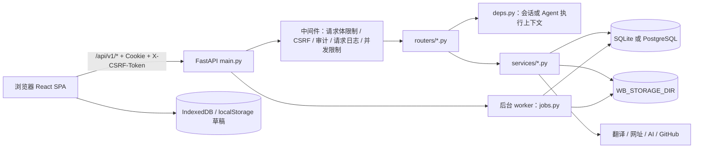
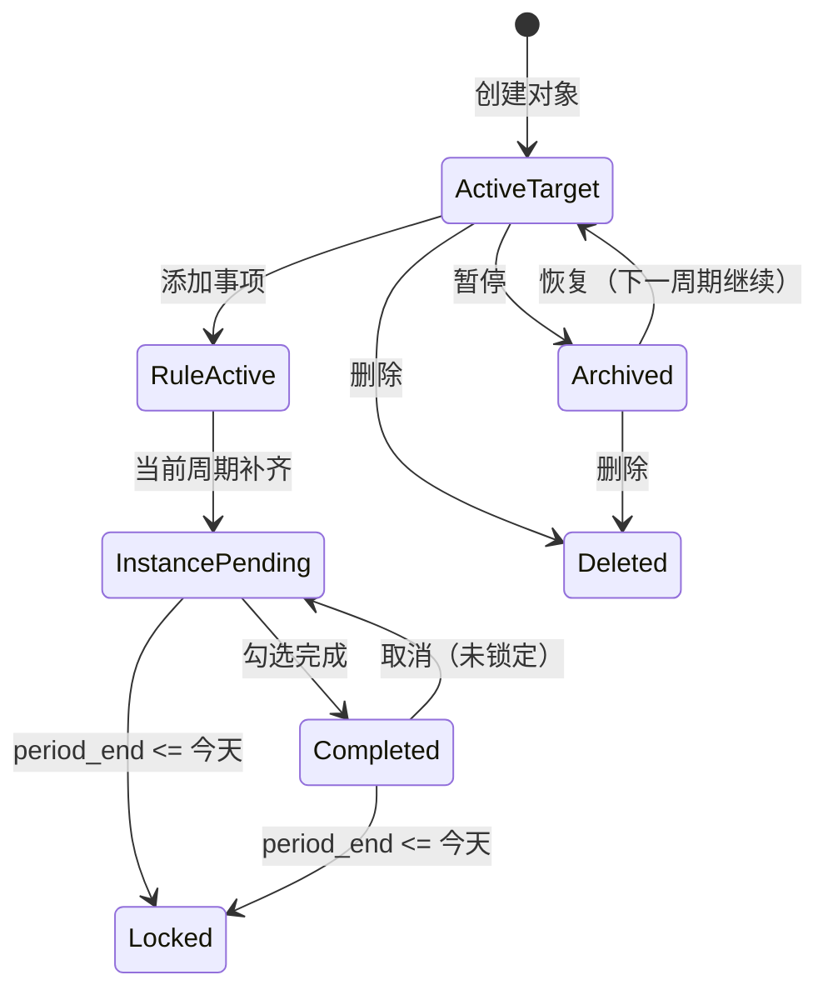
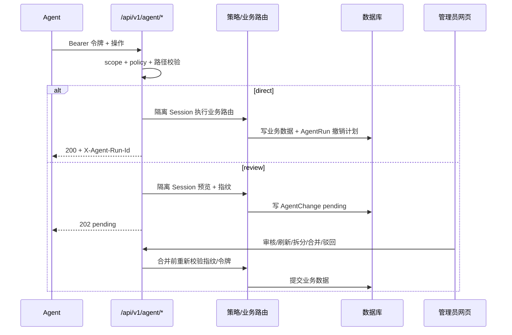
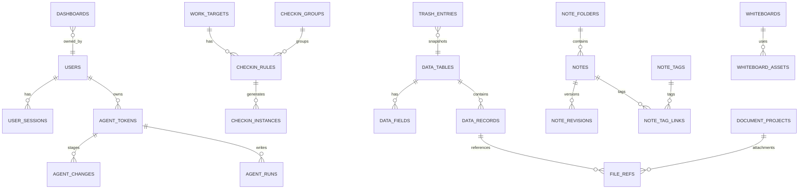

# 个人工作台（Workbench / Nexus）

> 主仓库：<https://github.com/weiwen778/workbench.git>
> 历史仓库：<https://github.com/weiwen778/workbench_element>

单用户、自托管的个人经营工作台。它把打卡、表格、看板、待办、笔记、便利贴、网址、翻译、文档处理、白板和若干浏览器端小工具放进同一套界面，数据保存在自己的机器或服务器上。图片、PDF、工作簿、文档转换、取色和二维码默认在浏览器完成；只有显式保存、上传、提交或后台任务才写服务器。

本文是 2026-11-20 按当前工作区代码重写的新人交接说明。审查时工作区已有未提交修改（看板默认值、表格空行校验/数字格式、fake-IP 配置、若干界面修复），本文按这些修改后的实际代码编写，没有回退或删除用户改动。历史文档只作为线索，最终以当前代码、测试和本次实际运行结果为准。

---

## 0. 阅读约定

功能状态统一使用：

- **已接入**：前端有入口，后端有实现，调用链可以追踪。
- **条件可用**：代码已接入，但需要管理员、开关、外部密钥或外部网络才能使用。
- **部分接入**：只实现了一部分，或只有接口没有当前页面入口。
- **已下线/兼容**：当前界面不再提供新建入口，但旧数据、旧接口或后台读取仍可能依赖。
- **待确认**：缺少运行证据，或无法从仓库确认外部依赖。

“功能已接入”和“本次测试通过”是两件事。第 6 节分别记录仓库已有测试和本次实际执行结果。

---

## 1. 项目简介

### 1.1 解决的问题

面向个人或极小团队，把原本散落在 Excel、备忘录、在线文档、白板和多个网页工具里的日常经营动作收拢到一个自托管系统：

- 每天/每周/每月要做的打卡事项，按周期生成、完成、锁定并保留历史快照。
- 经营数据用数据库表格管理，支持字段、筛选、排序、分页、公式、导入导出、汇总透视和 AI 图片填表。
- 基于表格的指标卡、柱状图、折线图、饼图和任务进度看板；任务进度卡片可下钻到来源记录。
- 待办、笔记、便利贴、网址导航和翻译等轻量内容。
- 浏览器端 PDF、工作簿、Markdown 文档、图片、格式转换、取色、二维码工具。
- 白板、附件、回收站、加密备份、运行日志和 GitHub Issue 反馈。
- 给外部 Agent 的受限接入：令牌、细粒度策略、直接写入或先暂存、操作记录与撤销。

### 1.2 目标用户与边界

- 当前产品按**单用户工作台**使用。启动时只创建一个管理员账号，没有注册、用户管理或角色分配页面。
- 业务表大多没有 `user_id` 字段；不能把它当作多租户系统。只有看板、白板、文档项目和 Agent 令牌等少数表带用户归属。
- 不提供公开分享、协作编辑、评论、审批流、支付、短信/邮件通知。
- 不承诺替代专业财务、ERP、CRM 或在线 Excel；表格与看板是个人经营台账级别的工具。
- 默认部署是 HTTP，适合本机/内网。对公网必须在外层终止 TLS 并设置 `WB_COOKIE_SECURE=true`。

### 1.3 当前已覆盖的核心流程

1. 管理员登录 → 建打卡对象/分类/事项 → 系统按周期生成实例 → 完成/取消/备注 → 周期结束自动锁定 → 历史与统计。
2. 建表格 → 配字段 → 录入/筛选/排序 → 导入/导出 → 汇总透视 → 看板图表 → 任务进度下钻来源记录。
3. 建待办清单 → 添加任务/子任务 → 截止时间与逾期 → 完成/取消 → 删除进回收站 → 30 天内恢复。
4. 笔记/便利贴/网址的增删改查、搜索、分类/标签。
5. PDF/工作簿/Markdown 文档的本地编辑与项目保存；白板本地草稿与服务器保存。
6. Agent 持令牌通过 `/api/v1/agent/*` 读写，按策略直写或暂存，管理员在设置页审核/撤销。
7. 运行日志、问题反馈、服务器指标、加密备份与恢复、回收站清理。

### 1.4 当前交付状态（2026-11-20）

- 当前分支 `main`，最新提交 `a8c6981 docs: 更新日志与反馈功能状态`；工作区有未提交修改，详见文末“本次审查说明”。
- 后端 `pytest` 共收集 **412** 项，本次全部通过。
- 前端 `npm run typecheck` 通过；`npm run build` 通过，输出到 `web/dist` 并生成 Brotli/Gzip 预压缩文件。
- 本次在临时 SQLite 实例上验证了登录、打卡、表格、看板、笔记、便利贴、网址、白板、待办、回收站、后台导出等主流程；详见第 6 节。
- 2026-11-16 完成过一轮全项目安全审查并修复多项问题；关键结论仍有效，摘要见附录 A。
- Docker Compose、真实 PostgreSQL、真实翻译/AI/GitHub 外部服务、复杂 PDF/工作簿往返和完整 Playwright 套件本次**未执行**，原因见第 9 节。

---

## 2. 快速启动

### 2.1 版本要求与依据

| 组件 | 要求 | 依据 |
| --- | --- | --- |
| Python | 3.12 | `server/Dockerfile` 使用 `python:3.12-slim-trixie`；`scripts/wb.sh` 用 `python3.12` 建 venv。本次验证使用 `server/.venv` 的 Python 3.12.16。 |
| Node.js | 20+（本次本机 24.22.1；Docker 构建镜像为 Node 22） | `web-react/Dockerfile` 使用 `node:22-alpine`；Vite 6/React 18 本身支持 Node 20+。 |
| npm | 随 Node 提供；本次 11.19.1 | `package-lock.json` 存在，安装使用 `npm ci`。 |
| 数据库 | 本地/测试 SQLite；生产 PostgreSQL 16 | `server/app/config.py` 默认 `sqlite:///./data/workbench.db`；`docker-compose.yml` 使用 `postgres:16-alpine`；生产启动校验拒绝 SQLite。 |
| 反向代理 | Nginx 1.27（Compose）或等价反代 | `web-react/Dockerfile`、`deploy/nginx.conf`。 |
| 其他 | `pg_dump`/`pg_restore`（运维备份、PostgreSQL 应用内备份） | `deploy/backup.sh`、`deploy/restore.sh`、`server/app/services/backups.py`。 |

`server/.venv` 已存在时可直接使用；新建环境时若系统命令不是 `python3.12`，请替换为实际的 3.12 解释器。

### 2.2 环境配置

配置全部来自 `WB_` 前缀环境变量。模板：

- Compose/生产：[`.env.example`](.env.example)
- bare-metal 开发：[`server/.env.example`](server/.env.example)

至少需要：

```dotenv
WB_ADMIN_USERNAME=admin
WB_ADMIN_PASSWORD=请换成至少12位的强密码
WB_ENCRYPTION_KEY=用下面的命令生成
WB_PUBLIC_BASE_URL=http://127.0.0.1:18080
WB_COOKIE_SECURE=false
```

生成 Fernet 主密钥：

```bash
python3 -c "from cryptography.fernet import Fernet; print(Fernet.generate_key().decode())"
```

注意：

- `WB_ENCRYPTION_KEY` 用于加密翻译/AI/GitHub 凭据和 Agent 暂存内容。丢失后旧密文无法解密，只能重新填写凭据。
- 生产环境必须设置主密钥、管理员密码至少 8 位（建议 12+）且不能是仓库示例/常见弱口令、必须使用 PostgreSQL；校验位置是 `server/app/main.py` 的 `bootstrap()` 和 `_validate_production_password()`。
- 不要把真实 `.env`、密钥、密码、客户数据提交到仓库。本文不记录任何真实凭据。

### 2.3 后端 bare-metal

```bash
cd server
python3.12 -m venv .venv
.venv/bin/pip install -r requirements.txt
cp .env.example .env
# 编辑 .env，至少设置 WB_ADMIN_PASSWORD 和 WB_ENCRYPTION_KEY
.venv/bin/alembic upgrade head
.venv/bin/uvicorn app.main:app --host 127.0.0.1 --port 18080
```

开发环境启动时会执行 `init_db()`（`create_all`）并创建管理员；生产环境不执行 `create_all`，只依赖 Alembic 迁移。

健康检查：

```bash
curl -fsS http://127.0.0.1:18080/api/v1/health
# 预期：{"status":"ok","database":"ok","translation":{...}}
```

接口文档：<http://127.0.0.1:18080/api/docs>；OpenAPI：`/api/openapi.json`。

项目也提供 WSL/Linux 启停脚本：

```bash
scripts/wb.sh install     # 建 venv、装后端依赖、npm ci + 构建前端
scripts/wb.sh start       # 默认 127.0.0.1:18080
scripts/wb.sh status
scripts/wb.sh logs
scripts/wb.sh restart
scripts/wb.sh stop
scripts/wb.sh reset       # 删除 server/data 后重启，仅本地开发
```

`scripts/dev-server.sh` 是更轻量的本地启停脚本；若端口已有 systemd 服务，它会直接复用。

### 2.4 前端开发模式

```bash
# 终端 1：后端热重载
cd server
.venv/bin/uvicorn app.main:app --reload --port 18080

# 终端 2：Vite 开发服务器
cd web-react
npm ci
npm run dev
```

Vite 监听 `127.0.0.1:5174`，`/api` 代理到 `http://127.0.0.1:18080`（见 `web-react/vite.config.ts`）。

### 2.5 前端生产构建

```bash
cd web-react
npm ci
npm run typecheck
npm run build
```

`build` 依次执行 `tsc -b`、Vite 构建和 `scripts/precompress.mjs`，输出到 `web/dist`。构建后由 FastAPI 的 `_mount_spa()` 静态托管；`web-react/node_modules`、`web-react/dist`、`web/dist` 都不应提交。

Univer 依赖必须保持 1.5.x 全套同版本。若镜像报 `ETARGET 404 @univerjs/rpc@1.5.0`，改用官方源重装：

```bash
npm install --registry=https://registry.npmjs.org
```

### 2.6 Docker Compose

```bash
cp .env.example .env
# 必填：WB_DB_PASSWORD、WB_ADMIN_PASSWORD、WB_ENCRYPTION_KEY
# 建议：WB_PUBLIC_BASE_URL、WB_COOKIE_SECURE、WB_BIND_ADDRESS
docker compose up -d --build
docker compose ps
docker compose logs -f api
```

默认拓扑见 `docker-compose.yml`：

| 服务 | 作用 | 端口/卷 |
| --- | --- | --- |
| `db` | PostgreSQL 16 | 仅绑定 `127.0.0.1:${WB_DB_PORT:-5433}`；卷 `wb_pgdata` |
| `api` | FastAPI，启动命令先 `alembic upgrade head` 再 uvicorn | 仅绑定 `127.0.0.1:${WB_API_PORT:-8000}`；卷 `wb_storage`、`wb_backups`、`wb_metrics` |
| `web` | Nginx 托管 SPA 并反代 `/api/` | 对外 `${WB_BIND_ADDRESS:-0.0.0.0}:${WB_HTTP_PORT:-18743}` |
| `host-metrics` | 只读采集宿主机 CPU/内存/磁盘/网络 | 写入 `wb_metrics`，由 API 读取 |

对外网部署时：在外层终止 TLS，设置 `WB_PUBLIC_BASE_URL=https://…`、`WB_COOKIE_SECURE=true`、`WB_BIND_ADDRESS=127.0.0.1`；只放行 80/443，不要暴露 8000、5433、18743。

升级：

```bash
git pull --ff-only
cd web-react && npm ci && npm run build
cd ..
docker compose build
docker compose up -d
docker compose exec -T api alembic upgrade head   # 入口通常已执行
curl -fsS http://127.0.0.1:${WB_HTTP_PORT:-18743}/api/v1/health
```

升级前先做备份。迁移不可逆时先在隔离实例验证，不要直接对生产库试降级。

### 2.7 测试数据与开发账号

- 首次启动自动创建管理员：用户名取 `WB_ADMIN_USERNAME`，密码取 `WB_ADMIN_PASSWORD`；不会自动创建其他账号。
- 开发模板默认是 `admin/admin12345`，仅用于本地；对外前必须修改。
- 可选模拟数据脚本（不会调用外部 API）：

```bash
# 5 张表、默认每表 1 万行，使用独立 SQLite 预览库
server/.venv/bin/python scripts/seed_mock_data.py seed --preview

# 一年经营模拟数据；--preview 使用独立 SQLite
server/.venv/bin/python scripts/demo_year.py --preview
server/.venv/bin/python scripts/demo_year.py status
server/.venv/bin/python scripts/demo_year.py remove --confirm <manifest 中的 marker>
```

`seed_mock_data.py` 非 `--preview` 时只允许本机 `workbench_element_local` 数据库；`demo_year.py` 只允许本地库，并在写入前生成 manifest，删除需要 manifest 中的 marker 确认。不要在正式库上试这些脚本。

### 2.8 启动后的首个验证

1. 打开 `http://127.0.0.1:18080`，应跳转 `/login`。
2. 用管理员登录，应进入 `/checkins`。
3. 点“管理打卡项目”新建一个打卡对象，再在对象详情里加一个“每天”的事项；返回打卡页应看到今日事项。
4. 勾选完成，进度环和“已完成/总数”应变化；点“历史”能看到刚才的记录。
5. 侧栏“表格”新建一张表，添加一行，刷新后数据仍在。
6. 顶栏“搜索或跳转”按 `Ctrl+K` 可搜索；右上角任务中心可看后台任务。

### 2.9 构建产物与部署入口

- 前端产物：`web/dist/`（`index.html` + `assets/` + `pdfjs/` 等静态资源）。
- 后端镜像：`server/Dockerfile`，入口 `alembic upgrade head && exec uvicorn app.main:app --host 0.0.0.0 --port 8000 --proxy-headers`。
- Web 镜像：`web-react/Dockerfile`，Nginx 配置 `deploy/nginx.conf`。
- 运维备份/恢复：`deploy/backup.sh`、`deploy/restore.sh`。
- 应用内加密备份/恢复：`server/app/services/backups.py`、`scripts/restore_backup.py`。
- 仓库没有独立的 CI 工作流文件；当前质量门禁以本地命令和 `server/tests` 为准。

---

## 3. 技术架构与目录导航

### 3.1 主要技术

- 前端：React 18 + TypeScript + Vite 6 + MUI 6 + MUI X DataGrid/Charts；CodeMirror、Univer 1.5、Excalidraw、pdf.js/pdf-lib、SheetJS、Dexie、DOMPurify。
- 后端：FastAPI + SQLAlchemy 2 + Alembic + Pydantic v2；同步 SQLAlchemy Session；单 Uvicorn 进程 + 单后台任务 worker。
- 数据：SQLite（本地/测试）或 PostgreSQL 16（生产）；附件在 `WB_STORAGE_DIR`；备份在 `WB_BACKUP_DIR`。
- 鉴权：单管理员 + 服务端 Session Cookie + CSRF 双提交 Cookie；Agent Bearer Token + scope + 细粒度 policy。
- 外部服务：翻译供应商、网址元数据、智谱 AI、GitHub Issue。后端统一走 SSRF 校验/超时/响应体上限。

### 3.2 请求流转



关键边界：

- 浏览器本地处理：图片、PDF、工作簿、文档转换、取色、二维码。未保存的文件不上传。
- 后端持久化：显式保存、上传附件、保存白板、提交表单、后台导入/导出/备份才写库或写文件。
- 生产启动只执行 Alembic，不执行 `create_all`，避免结构漂移。
- 会话 Cookie 是 HttpOnly；CSRF 使用非 HttpOnly 的 `wb_csrf`，前端从 Cookie 读取并放到 `X-CSRF-Token`。
- 审计中间件对非 Agent 内部请求的写操作记录 `operation_logs`；请求日志进入 `app_logs`。

### 3.3 目录结构

```text
server/
  app/
    main.py             应用装配、CSRF、上传体限制、审计/请求日志、SPA 托管
    config.py           WB_* 环境变量
    db.py               SQLAlchemy engine/session、init_db
    models.py           全部 ORM 模型
    deps.py             会话/管理员/Agent 执行上下文鉴权
    agent_policy.py     Agent 模块/表/操作/文件/外部/不可逆策略
    agent_access.py     Agent 令牌解析与 scope
    agent_runtime.py    Agent 隔离 Session/执行上下文
    routers/            HTTP 路由（按业务分文件）
    services/           备份、任务、表达式、导入导出、SSRF、日志、回收站等
    migrations/         Alembic 迁移（实际位于 server/migrations）
  tests/                pytest 用例
  requirements.txt
  requirements.lock
  alembic.ini
  Dockerfile
web-react/
  src/
    App.tsx             路由与登录守卫
    pages/              页面（打卡、表格、看板、待办、笔记等）
    layout/             侧栏、导航顺序
    components/         共享组件（DataTable、TableView、RecordDrawer、导入向导等）
    docs/               PDF / 工作簿 / Markdown 文档
    docs/sheet/         Univer 工作簿 + SheetJS 桥接
    analysis/           汇总/透视 Worker
    convert/            图片/PDF/表格转换
    storage/            Dexie/IndexedDB 草稿
    whiteboard/         白板 API、IndexedDB 草稿、场景工具
    api/client.ts       axios、CSRF、错误归一
    session.ts          登录态、主题、退出
  package.json
  vite.config.ts
web/
  public/               favicon、PDF.js、字体等静态资源
  dist/                 构建产物（Git 忽略，由后端托管）
e2e/                    Playwright 端到端脚本（部分为历史脚本）
scripts/                启停、模拟数据、性能、报告
deploy/                 Nginx、运维备份/恢复
docs/                   PRD、模块设计、审查记录
```

### 3.4 最常改动的文件

| 文件/函数 | 作用 |
| --- | --- |
| `server/app/main.py` `create_app()`、`bootstrap()`、`_mount_spa()` | 路由装配、CSRF、请求体限制、生产校验、SPA 托管 |
| `server/app/config.py` `Settings` | 所有环境变量与默认值 |
| `server/app/models.py` | 表结构与实体关系 |
| `server/app/deps.py` `get_current_user()`、`get_admin_user()` | 网页会话与管理员边界 |
| `server/app/agent_policy.py` `check_policy()` | Agent 细粒度权限 |
| `server/app/routers/tables.py` `validate_record()` 调用点、`_has_record_content()` | 表格字段/记录规则 |
| `server/app/services/fields.py` `validate_value()`、`validate_record()` | 字段类型校验（前后端双校验的服务端部分） |
| `server/app/routers/transfers.py` `preview_import()`、`confirm_import()`、`export_table()` | Excel/CSV/JSON 导入导出 |
| `server/app/services/dashboard.py` `aggregate()`、`validate_source()` | 看板聚合与字段校验 |
| `server/app/routers/checkins.py`、`services/checkins.py` | 打卡实例生成、完成、锁定、统计 |
| `server/app/services/backups.py` | 应用内加密备份、校验、解包 |
| `server/app/services/jobs.py` | 后台任务队列与 worker |
| `web-react/src/App.tsx` | 前端路由与登录守卫 |
| `web-react/src/layout/app-nav.ts`、`nav.ts` | 侧栏入口、模块二级导航 |
| `web-react/src/components/TableView.tsx` | 表格主界面、筛选、内联编辑、导入/导出入口 |
| `web-react/src/components/RecordDrawer.tsx` | 单行编辑、附件、版本冲突 |
| `web-react/src/components/FieldManager.tsx` | 字段增删改、公式、显示格式 |
| `web-react/src/pages/Dashboard.tsx` | 看板列表、图表编辑器、日期筛选、AI 入口 |
| `web-react/src/api/client.ts`、`src/session.ts` | CSRF、错误提示、登录态与主题 |

### 3.5 数据保存位置

```text
SQLite（开发默认）      server/data/workbench.db
PostgreSQL（生产）      WB_DATABASE_URL / Compose db 服务
WB_STORAGE_DIR/
  files/                用户上传附件（uuid 文件名）
  exports/              表格后台导出文件（export_ 前缀）
  whiteboards/          白板图片资源
  agent-staging/        Agent 暂存上传
  agent-results/        Agent 合并产生的二进制结果
WB_BACKUP_DIR/
  recovery.key          应用内备份恢复密钥（必须单独离线保存）
  backup-*.wbbackup     加密备份归档
  备份元数据 *.json
浏览器：
  IndexedDB nexus-workbench     文档草稿
  IndexedDB nexus-whiteboard    白板本地草稿
  localStorage wb_*             表格列宽/显隐、视图、最近打开、草稿、导航偏好
```

文档项目的编辑状态存在 `document_projects.state`（JSON）；工作簿项目保存的 XLSX/Univer 快照作为 `files` 附件和 `file_refs` 引用，不单独建 `document-projects/` 目录。

---

## 4. 功能索引与逐项说明

### 4.0 功能索引

| 模块 | 功能 | 用户入口 | 可用角色或启用条件 | 接入状态 | 详情 |
| --- | --- | --- | --- | --- | --- |
| 账号 | 登录、会话、改密、退出 | `/login`；设置 → 登录与安全 | 唯一管理员 | 已接入 | [4.1](#41-登录会话与安全) |
| 系统 | 全局搜索、任务中心、操作记录 | 顶栏搜索/Ctrl+K、任务中心 | 管理员 | 已接入 | [4.2](#42-全局搜索任务中心与操作记录) |
| 打卡 | 今日/本周/本月打卡 | `/checkins`、`/checkins/items/:targetId` | 管理员 | 已接入 | [4.3](#43-打卡中心今日本周本月) |
| 打卡 | 对象、分类、事项、周期规则 | 打卡页 → 管理打卡项目；`/checkins/targets/:id` | 管理员 | 已接入 | [4.4](#44-打卡项目分类与周期规则) |
| 打卡 | 历史、统计、JSON 导入 | 打卡页“历史”“导入” | 管理员 | 已接入 | [4.5](#45-打卡历史统计与导入) |
| 待办 | 清单、任务、子任务、完成区 | `/todos/:listId?` | 管理员 | 已接入 | [4.6](#46-待办) |
| 表格 | 表格库、搜索、收藏、最近打开 | `/data` | 管理员 | 已接入 | [4.7](#47-表格库) |
| 表格 | 字段、公式、显示格式 | 表格 → 更多 → 列设置 | 管理员 | 已接入 | [4.8](#48-表格字段与公式) |
| 表格 | 记录、筛选、排序、分页、内联编辑 | `/data/:tableId` | 管理员 | 已接入 | [4.9](#49-表格记录筛选与分页) |
| 表格 | Excel/CSV/JSON 导入 | 表格库“导入”或表格内“批量导入” | 管理员；Agent 需 `allow_files` | 已接入 | [4.10](#410-表格导入) |
| 表格 | 导出、后台任务 | 表格 → 更多 → 导出；任务中心 | 管理员；Agent 需 `allow_files` | 已接入 | [4.11](#411-表格导出与后台任务) |
| 表格 | 汇总与透视 | 表格 → 更多 → 汇总与透视 | 管理员 | 已接入 | [4.12](#412-汇总与透视) |
| AI | AI 图片/文字填表 | 表格 → AI 填入；设置 → AI 能力 | 需配置智谱 API Key；仅浏览器 | 条件可用 | [4.13](#413-ai-图片文字填表) |
| 看板 | 指标卡、柱/折/饼图、任务进度、进度下钻 | `/visualizations/:dashboardId?` | 管理员 | 已接入 | [4.14](#414-数据可视化) |
| 笔记 | 文件夹/标签/Markdown/历史/导出 | `/notes/:folderKey?` | 管理员 | 已接入 | [4.15](#415-笔记) |
| 便利贴 | 六色便利贴、分类、排序、发到白板 | `/memos` | 管理员 | 已接入 | [4.16](#416-便利贴) |
| 网址 | 分类、元数据、测速、全部打开 | `/bookmarks` | 管理员；元数据需外部网络 | 已接入 | [4.17](#417-网址导航) |
| 翻译 | 多供应商翻译、历史、收藏 | `/translate`；设置 → 翻译服务 | 需主密钥 + 供应商凭据 | 条件可用 | [4.18](#418-翻译) |
| 文档 | PDF 编辑、工作簿、Markdown 文档 | `/docs` | 管理员；浏览器本地 | 已接入 | [4.19](#419-文档工作台) |
| 白板 | 场景编辑、图片资源、草稿、PNG 导出 | `/whiteboards`、`/whiteboards/:boardId` | 管理员 | 已接入 | [4.20](#420-白板) |
| 工具 | 图片批处理、拼图、切图 | `/images` | 管理员；浏览器本地 | 已接入 | [4.21](#421-图片处理) |
| 工具 | 图片/PDF/CSV/Excel 转换 | `/convert` | 管理员；浏览器本地 | 已接入 | [4.22](#422-格式转换) |
| 工具 | 图片取色、颜色格式 | `/color` | 管理员；浏览器本地 | 已接入 | [4.23](#423-取色与颜色格式) |
| 工具 | 二维码/条码生成与识别 | `/codes` | 管理员；浏览器本地 | 已接入 | [4.24](#424-二维码与条码) |
| 系统 | 运行日志 | 设置 → 运行日志 | 管理员 | 已接入 | [4.25](#425-运行日志) |
| 系统 | GitHub Issue 反馈 | 顶栏反馈按钮；设置 → 问题反馈 | 需配置 GitHub PAT/仓库 | 条件可用 | [4.26](#426-问题反馈) |
| Agent | 令牌、直写/审核、撤销、活动 | 设置 → Agent 接入；`/api/v1/agent/*` | Bearer 令牌 + scope + policy | 已接入 | [4.27](#427-agent-接入) |
| 系统 | 应用内加密备份、恢复密钥、校验 | 设置 → 备份与恢复；任务中心 | 管理员网页会话 | 条件可用 | [4.28](#428-备份与恢复) |
| 系统 | 回收站恢复/永久清理 | 设置 → 回收站；`/trash` 跳转 | 管理员 | 已接入 | [4.29](#429-回收站) |
| 系统 | 外观、内容显示、导航、运行状态、安全 | `/settings/*` | 管理员 | 已接入 | [4.30](#430-设置偏好与运行状态) |
| 兼容 | 虚拟表 | 无新建入口；旧看板/接口可读 | 旧数据 | 已下线/兼容 | [7](#7-历史留存兼容与冗余) |
| 兼容 | 增强表格视图/事务/工作簿接口 | 无当前页面入口 | 旧前端/Agent | 部分接入 | [7](#7-历史留存兼容与冗余) |

### 4.1 登录、会话与安全

- **用途**：管理员进入工作台，维护登录态、改密和退出。
- **操作入口**：页面 `/login`；设置 → 登录与安全 `/settings/security`；API `/api/v1/auth/login`、`/auth/logout`、`/auth/me`、`/auth/password`。
- **前置条件**：数据库中存在用户；首次启动由 `bootstrap()` 创建 `WB_ADMIN_USERNAME` 对应的账号。
- **正常流程**：GET 任意页面触发 CSRF Cookie → 提交用户名/密码 → 服务端校验 PBKDF2 哈希 → 写入 `user_sessions` 并下发 HttpOnly Session Cookie → 前端 `loadSession()` 读取 `/auth/me` → 进入 `/checkins`。
- **业务规则**：
  - 密码使用 PBKDF2-HMAC-SHA256，210,000 次迭代；Session 固定 30 天，不续期。
  - 同一用户名 + IP 在 `WB_LOGIN_LOCK_SECONDS` 内失败达到 `WB_LOGIN_MAX_FAILURES` 次后返回 429；**没有全局账号锁**，避免匿名请求锁死唯一管理员。
  - 登录失败统一返回“用户名或密码不正确”，不暴露账号是否存在。
  - 修改密码校验旧密码，新密码至少 8 位且不能与旧密码相同；吊销其他网页会话，并同时撤销该用户的全部 Agent 令牌。
  - 退出吊销当前会话；前端清理当前用户的文档草稿。
  - 所有写请求要求 `X-CSRF-Token` 与 `wb_csrf` Cookie 一致；登录接口豁免。
- **实现链路**：`server/app/routers/auth.py` → `server/app/security.py` → `server/app/deps.py`；中间件在 `server/app/main.py` `_csrf_and_cookie`；前端 `web-react/src/session.ts`、`src/api/client.ts`、`src/pages/Login.tsx`。
- **数据变化**：写入/更新 `user_sessions`、`login_attempts`；改密更新 `users.password_hash`、`password_changed_at`，并撤销 `agent_tokens`。
- **权限执行位置**：业务路由默认 `Depends(get_current_user)`；管理员专属接口用 `get_admin_user`（`deps.py`），同时拒绝 Agent 执行上下文和 `Authorization` 头。
- **测试与验收**：`server/tests/test_auth.py`（15 项）、`test_security_regressions.py`；手工用例 A01–A04。
- **变更影响**：改 Cookie 名/CSRF 名/登录策略会影响所有前端请求、反代和 Agent 管理接口；改密码逻辑会影响 Agent 令牌生命周期。
- **已知限制**：没有多因素认证、没有找回密码、没有多用户管理；默认 HTTP 部署时 Cookie 不加密传输。

### 4.2 全局搜索、任务中心与操作记录

- **用途**：跨模块搜索；查看后台任务、Agent 待审核/操作记录和最近操作。
- **操作入口**：顶栏“搜索或跳转”/`Ctrl+K`；任务中心图标；`/api/v1/search`、`/tasks`、`/tasks/summary`、`/tasks/{id}`、`/activity`。
- **前置条件**：已登录。
- **正常流程**：输入关键词 → 服务端按模块查 `todos/notes/memos/bookmarks/tables/records` → 返回最多 20 条/模块 → 点击结果跳转对应页面并在部分页面高亮/定位记录。任务中心显示 queued/running/failed/completed 和 Agent pending 数量。
- **业务规则**：
  - 搜索关键词 1–100 字符；`kind=all` 时每模块最多 20 条，指定模块才分页；`total_is_exact` 标识是否精确。
  - 表格记录搜索使用 JSON 值匹配，结果链接带 `?record=`。
  - 任务中心每页 20 条；失败/取消任务可重试；运行中任务可请求取消（队列中直接取消，运行中设置 `cancel_requested`）。
  - 操作记录来自审计中间件，只记录非 Agent 内部、非 `/auth/*` 的成功写操作。
- **实现链路**：`server/app/routers/workspace_tools.py`、`server/app/main.py` `_audit`、`web-react/src/components/GlobalSearchDialog.tsx`、`WorkspaceToolsDialog.tsx`、`AppLayout.tsx`。
- **数据变化**：搜索只读；任务中心读取 `background_jobs`/`agent_changes`；操作记录读取 `operation_logs`。
- **权限执行位置**：`workspace_tools.py` 使用 `get_current_user`；备份相关端点单独使用 `get_admin_user`。
- **测试与验收**：`server/tests/test_workspace_tools.py`；手工用例 A05。
- **变更影响**：新增模块若希望被全局搜索覆盖，需要同时修改 `workspace_tools.search()` 的模型表和前端链接映射。
- **已知限制**：`kind=all` 的总数不是精确总数；搜索结果只覆盖预留的六类资源。

### 4.3 打卡中心（今日/本周/本月）

- **用途**：按日/周/月查看要做的打卡事项，完成、取消、写备注并看完成率。
- **操作入口**：`/checkins`、`/checkins/items/:targetId`、`/checkins/shops`、`/checkins/social`；API `/api/v1/checkin-instances`、`/checkin-instances/history`、`GET /checkin-instances/{id}`、`/checkin-instances/{id}/complete`、`/cancel`、`PATCH /checkin-instances/{id}`、`/checkin-statistics`。
- **前置条件**：至少一个 active 打卡对象，以及属于该对象的 active 事项。
- **正常流程**：进入页面 → 选择“今天/本周/本月”和状态 → 服务端补齐当前周期实例并按分类分组返回 → 勾选完成/取消 → 备注 → 刷新统计；周期结束后实例锁定，不能再补打卡/取消。
- **业务规则**：
  - 周期：日=自然日；周=周一开始的 7 天；月=自然月 1 日到月末；区间左闭右开，展示时前端把结束日减一天。
  - 读取当前周期时会按规则幂等补齐实例；同一 `rule_id + period_start` 唯一。
  - 停机遗漏的已结束周期会以未完成、只读形式补齐。
  - `period_end <= 今天` 即锁定；锁定原因可能是“周期已结束”“已暂停”“账号已删除”。
  - 重复完成不刷新完成时间、不重复计数；取消会清空完成时间并同步最新事项标题/说明/分组。
  - 统计只统计当前周期、未带“已暂停”锁定的实例；完成率 `rate` 在总数为 0 时为 `null`。
  - `kind` 只接受 `shop/social/all`；`period` 只接受 `daily/weekly/monthly`；`status` 只接受 `all/pending/done`。
- **实现链路**：`server/app/routers/checkins.py` → `server/app/services/checkins.py` → `services/periods.py`；前端 `web-react/src/pages/Checkin.tsx`。
- **数据变化**：读取时可能写 `checkin_instances`（补齐当前/历史周期）；完成/取消/备注更新实例；统计只读。
- **权限执行位置**：`checkins.py` 路由级 `get_current_user`；前端只负责禁用锁定项，服务端 `complete_instance()`/`cancel_instance()` 再次检查 `locked` 并返回 409。
- **测试与验收**：`server/tests/test_checkins.py`（25 项）；手工用例 A06–A08。
- **变更影响**：周期算法、锁定规则和实例补齐会影响统计、历史、看板进度和 Agent 读取；改 `period_bounds()` 会波及所有周期功能。
- **已知限制**：`GET /checkin-instances` 会补齐周期并写库，读接口带写事务；高并发下需要评估（见第 9 节）。

### 4.4 打卡项目、分类与周期规则

- **用途**：维护“店铺/社媒账号”对象、分类和每个对象下的打卡事项。
- **操作入口**：打卡页“管理打卡项目”；对象详情 `/checkins/targets/:id`；API `/work-targets*`、`/checkin-groups*`、`/work-targets/{id}/rules`、`/checkin-rules/{id}`、`/checkin-rules/{id}/versions`。
- **前置条件**：管理员；创建事项前对象必须 active，且至少有一个分类。
- **正常流程**：新建对象 → 新建/选择分类 → 添加事项（标题、分类、频率、说明）→ 事项立即进入当前对应周期 → 可编辑/停用/查看改动历史 → 可暂停/恢复/删除对象。
- **业务规则**：
  - 对象 `kind` 为 `shop|social`；同类型 active 对象不能重名；删除是软删（`status=deleted`），历史实例保留并锁定。
  - 暂停对象会把已有实例全部标记 `locked + 已暂停`，从日常清单隐藏；恢复后从下一个对应周期继续，归档期间不补工作（`generate_from` + `ActivityInterval`）。恢复时若已有同名 active 对象，会 409 `NAME_DUPLICATED`。
  - 事项必须属于 active 对象；频率只接受 `daily/weekly/monthly`；新增事项立即进入当前周期。
  - 修改频率是特殊变更：保留旧周期当前实例，新频率从“下一个对应周期”生效，返回 `period_change.effective_from`；未到生效日之前显示“待生效”。
  - 修改标题/说明/分类/启用状态会更新当前未完成且未锁定实例；已完成/历史实例保留旧快照。
  - 删除分类时，如果仍有关联事项或未完成实例，必须传 `move_to` 指定接收分类；否则 409 `GROUP_IN_USE`。
  - 删除事项是“停用”，不会删除历史实例。
- **实现链路**：`server/app/routers/targets.py`；`services/checkins.py` 的 `change_rule_period()`、`ensure_target_period()`、`collapse_pending()`；前端 `Checkin.tsx` 的管理抽屉、`TargetDetail.tsx`。
- **数据变化**：写 `work_targets`、`checkin_groups`、`checkin_rules`、`checkin_rule_versions`、`activity_intervals`、`checkin_instances`。
- **权限执行位置**：`targets.py` 路由级 `get_current_user`；服务端校验对象/分类/事项关系，前端只做必填提示。
- **测试与验收**：`server/tests/test_checkins.py`、`test_checkin_import.py`；手工用例 A09–A11。
- **变更影响**：对象归档/恢复、分类删除、周期修改会影响打卡列表、统计、历史和看板进度；改快照字段要考虑旧数据读取。
- **已知限制**：分类删除必须转移；没有批量排序 API（前端逐条 `PATCH sort_order`）。

### 4.5 打卡历史、统计与导入

- **用途**：查历史周期、按状态/日期筛选、看完成率；从 JSON 模板批量建对象、分类和事项。
- **操作入口**：打卡页“历史”；“导入”/下载模板；API `/checkin-instances/history`、`/checkin-statistics`、`/checkin-imports`、`/checkin-imports/template`。
- **前置条件**：已登录；导入文件为 UTF-8 JSON。
- **正常流程**：历史弹窗选择周期、对象、状态、起止日期 → 分页查看；导入下载模板 → 填对象/分类/任务 → 选择文件 → 服务端逐项校验 → 成功后返回创建/复用/跳过统计。
- **业务规则**：
  - 历史 `page_size` 1–200，默认 50；按 `period_start` 倒序。
  - 导入最多 200 个对象、2000 个事项；对象名必填且 ≤100 字，事项标题必填且 ≤200 字，说明 ≤5000 字。
  - 频率支持“每天/每周/每月”及英文/简写；不写默认每天；未知频率报错。
  - 同名分类复用；同类型同名 active 对象复用；同一对象下同名事项跳过并返回 `skipped`。
  - 解析出任何错误时整批不导入（422 `IMPORT_INVALID`，最多返回 50 条错误）。
- **实现链路**：`server/app/routers/checkin_import.py`、`checkins.py`；前端 `Checkin.tsx` 导入弹窗。
- **数据变化**：写 `checkin_groups`、`work_targets`、`checkin_rules`、`checkin_rule_versions`、`activity_intervals`，并为新事项补齐当前周期实例。
- **权限执行位置**：路由级 `get_current_user`；服务端解析/校验，前端只做 JSON 解析提示。
- **测试与验收**：`server/tests/test_checkin_import.py`（9 项）；手工用例 A12。
- **变更影响**：导入是批量写；改字段别名、频率别名或去重规则会影响旧模板。
- **已知限制**：只支持 JSON，不支持 Excel 直接导入打卡；模板中的 `_说明` 字段被忽略。

### 4.6 待办

- **用途**：多清单管理任务，支持子任务、截止时间、完成区、手动排序、删除恢复。
- **操作入口**：`/todos/:listId?`；API `/todo-lists*`、`/todos*`。
- **前置条件**：至少一个清单；没有清单时页面引导新建。
- **正常流程**：新建清单 → 输入标题回车新增 → 可加子任务/截止日期/时间/备注 → 勾选完成 → 完成区折叠查看 → 可移动、拖动排序、删除；删除进回收站。
- **业务规则**：
  - 清单名称唯一；排序模式 `auto|manual`；拖动排序后自动切到 manual。
  - 只支持一层子任务；子任务必须与父任务同清单；子任务不能单独移动到其他清单。
  - 有子任务的父任务不能直接勾选完成/取消，完成状态由子任务推导；全部子任务完成时父任务自动完成，新增未完成子任务会使父任务恢复未完成。
  - 截止时间必须同时有日期；无时间按当天 23:59:59 判断逾期。
  - 分页：顶层任务每页最多 100，默认 50；完成区单独分页；`focus` 可定位到指定任务并自动翻到对应页。
  - 删除清单或任务前写回收站快照；恢复按树恢复。
- **实现链路**：`server/app/routers/todos.py`、`services/todo_recovery.py`；前端 `web-react/src/pages/Todos.tsx`。
- **数据变化**：`todo_lists`、`todos`、`trash_entries`；完成/取消更新 `completed_at` 和 `version`。
- **权限执行位置**：路由级 `get_current_user`；父子关系、完成规则在服务端校验。
- **测试与验收**：`server/tests/test_todos.py`（18 项）、`test_trash.py`；手工用例 A13–A15。
- **变更影响**：排序/分页/完成推导会影响侧栏待办计数、全局搜索和回收站恢复。
- **已知限制**：没有提醒/通知；没有重复任务；子任务只有一层。

### 4.7 表格库

- **用途**：管理数据库表格，作为记录、导入导出、汇总透视和看板的数据源。
- **操作入口**：`/data`；API `/tables`、`/tables/{id}`。
- **前置条件**：已登录。
- **正常流程**：新建空白表格或从文件导入 → 卡片/列表视图浏览 → 搜索名称/说明/字段 → 收藏/最近打开 → 打开表格 → 重命名/删除。
- **业务规则**：
  - 表格名称在未删除表格中唯一；最多 200 列。
  - 删除表格是软删，写入回收站；记录不立即物理删除。
  - 表格库查询排除 `kind=virtual` 的虚拟表。
  - 收藏、最近打开、卡片/列表视图保存在浏览器 localStorage，不写服务器。
  - 删除对话框可先导出备份；删除后前端清理本地收藏/最近记录。
- **实现链路**：`server/app/routers/tables.py` `list_tables/create_table/delete_table`；前端 `web-react/src/pages/Tables.tsx`、`components/DeleteTableDialog.tsx`。
- **数据变化**：写 `data_tables`；删除时写 `trash_entries`；收藏/最近只写 localStorage。
- **权限执行位置**：路由级 `get_current_user`；服务端校验重名和字段数量。
- **测试与验收**：`server/tests/test_tables.py`、`test_trash.py`；手工用例 A16。
- **变更影响**：表格列表被侧栏、全局搜索、看板数据源、导入向导共用；改返回字段要同步前端。
- **已知限制**：没有服务端分页的表格列表（返回全部未删除表）；没有表格级权限。

### 4.8 表格字段与公式

- **用途**：定义列类型、必填、默认值、选项、公式、数字显示格式和顺序。
- **操作入口**：表格 → 更多/视图 → 列设置；API `/tables/{id}/fields`、`/fields/{id}`。
- **前置条件**：表格存在；添加必填列且表内已有数据时需提供默认值。
- **正常流程**：添加列 → 选类型/必填/默认值/选项 → 公式列填写表达式或预设 → 拖动排序 → 保存；编辑时修改名称/必填/选项/公式/显示格式。
- **业务规则**：
  - 后端支持 `short_text/long_text/number/date/select/multiselect/checkbox/url/attachment/reference/formula/lookup/rollup`；当前列设置 UI 只暴露前 9 类 + `formula`。
  - 同表列名唯一；每表最多 200 列；单选/多选最多 100 个选项，选项 ID 必须唯一。
  - 已有非空数据（含回收站数据）的列不能直接改类型；需新建列迁移。
  - 把列改为必填前，所有活动记录该列必须非空，否则 409 `REQUIRED_CONFLICT`。
  - 删除被记录使用的选项会被 409 `OPTION_IN_USE` 拦截。
  - 删除列需要 `confirm=true`；会删除所有记录（含回收站）中该字段的值，并同步文件引用；列本身不进回收站。
  - 公式：1–1000 字符，只允许白名单 AST/函数（`F/SUM/AVG/MIN/MAX/COUNT/ROUND/ABS/IF/LEN/CONCAT/COALESCE/DATE_DIFF`），最多 160 个节点；计算列只读，保存时不能手改。
  - 数字默认 18 位总长度、最多 6 位小数；显示格式可选自动/数值/金额/百分比/整数/原样。
  - 普通数字列名称像“净额/利润/率/比”时前端提示“静态派生值，不会自动重算”，建议改用公式列。
  - 字段类型校验集中在 `services/fields.py`，导入、AI 填表和记录保存复用。
- **实现链路**：`server/app/routers/tables.py` `add_field/update_field/delete_field`；`services/fields.py`；`services/table_expressions.py`；前端 `components/FieldManager.tsx`、`src/table-core.ts`。
- **数据变化**：`data_fields`、`data_tables.schema_version`；必填默认值会回填活动记录；删列会改写 `data_records.data` 和文件引用。
- **权限执行位置**：路由级 `get_current_user`；`_lock_table()` 用 `schema_version` 做并发锁；服务端做类型/选项/版本校验。
- **测试与验收**：`server/tests/test_tables.py`（18 项）、`test_virtual_tables.py`；手工用例 A17–A19。
- **变更影响**：字段 key 是记录 JSON 的键；改 key/类型/选项会影响记录、看板、导入导出、Agent 和旧数据。删列不可从回收站恢复列结构。
- **已知限制**：UI 未提供 `reference/lookup/rollup` 创建入口；旧数据或 Agent 可能已有这些列。公式列有复杂度和行数上限。

### 4.9 表格记录、筛选与分页

- **用途**：录入、编辑、删除、筛选、排序、分页查看表格数据。
- **操作入口**：`/data/:tableId`；API `/tables/{id}/records`、`/records/{id}`、`/tables/{id}/records/batch-delete`。
- **前置条件**：表格至少有一列。
- **正常流程**：添加一行 → 填字段 → 保存 → 双击单元格内联编辑或打开整行抽屉 → 筛选/排序/翻页 → 勾选批量删除 → 删除进回收站。
- **业务规则**：
  - 新增/编辑后整行至少要有一列真实内容；未勾选的勾选框不算内容，数字 0 算内容；否则 422 `EMPTY_RECORD`。
  - 编辑带 `version` 时做乐观锁，不一致返回 409 `VERSION_CONFLICT` 和当前版本；前端提示“换成最新的/按我填的保存”。
  - 筛选最多 10 条、排序最多 3 列；`long_text/multiselect/attachment` 不支持排序。
  - 每页只允许 20/50/100；筛选/排序参数必须是 JSON 数组。
  - 单条删除和批量删除都是软删，写回收站；批量最多 100 条。
  - 附件字段保存后建立 `file_refs`；替换附件会解除旧引用，旧文件回到 staged 并在 24 小时后可清理。
- **实现链路**：`server/app/routers/tables.py`；`services/query.py`、`services/table_expressions.py`、`services/table_history.py`；前端 `components/TableView.tsx`、`RecordDrawer.tsx`。
- **数据变化**：`data_records`、`file_refs`、`table_changes`、`trash_entries`；内联编辑写 `data_records.version`。
- **权限执行位置**：路由级 `get_current_user`；服务端校验字段、空行、版本、筛选字段；前端只做即时提示。
- **测试与验收**：`server/tests/test_tables.py`、`test_table_workspaces.py`；手工用例 A20–A22。
- **变更影响**：记录结构被看板、导入导出、全局搜索、Agent、回收站共用；改空行/版本规则要回归这些入口。
- **已知限制**：筛选使用 JSON 文本/数值表达式，复杂计算列筛选会走内存计算路径，最多 10,000 行；表格没有实时协作。

### 4.10 表格导入

- **用途**：从 Excel/CSV/JSON 预览、映射字段并原子导入。
- **操作入口**：表格库“导入”/表格内“批量导入”；API `/imports/preview`、`/imports/{job_id}/draft`、`/imports/{job_id}/confirm`、`/imports/{source_id}/confirm-tasks`。
- **前置条件**：已登录；目标表可写（不能是虚拟表）；文件类型/大小在限制内。
- **正常流程**：上传文件 → 服务端解析首个/指定工作表 → 预览前 10 行和列映射 → 选择现有列或新建字段 → 检查错误 → 确认导入（后台任务）→ 任务中心查看进度和结果。
- **业务规则**：
  - 支持 `.xlsx/.xlsm/.xls/.csv/.json`；单文件 ≤20 MB；最多 1 万行、200 列、20 个工作表。
  - `.xlsx/.xlsm` 额外检查 ZIP 实际解压字节（总 64 MB、单 entry 64 MB、最多 5000 entry），伪造声明大小会被拒绝。
  - 第一行是标题行，不能有空列名或重复列名；全空行跳过但保留原行号。
  - 类型推断：勾选词、日期、数字、短文本；低基数短文本可自动推为单选（1–12 个唯一值且每个 ≤40 字）。
  - 已有表同名列自动映射；其余默认“创建为新字段”，可改成映射到现有列或忽略。
  - 新字段使用与 `/tables` 相同的字段校验：类型、重名、选项 ID、必填、公式配置。
  - 任意一行校验失败则整批不导入（422 `IMPORT_VALIDATION_FAILED`），不会部分写入。
  - 确认导入是幂等的：同一 job 已 success 时重复确认不会重复追加；后台任务用 `Idempotency-Key` 防重复。
  - 附件不能通过导入迁移，需导入后单独上传。
- **实现链路**：`server/app/routers/transfers.py` `preview_import/update_draft/confirm_import`；`services/archive_safety.py`；前端 `components/ImportWizard.tsx`；后台执行在 `services/jobs.py`。
- **数据变化**：`data_transfer_jobs`（预览/草稿）、`data_tables`/`data_fields`/`data_records`、`file_objects`（导出文件）；不写客户通知。
- **权限执行位置**：路由级 `get_current_user`；Agent 需要 `allow_files`（`is_files()`）；服务端做文件类型、ZIP、字段和整批校验。
- **测试与验收**：`server/tests/test_files_transfers.py`（21 项）、`test_large_exports.py`；手工用例 A23–A25。
- **变更影响**：改字段校验、类型推断、映射结构或 job payload 会影响旧预览任务和 Agent 导入；改 ZIP 限制会影响大文件导入。
- **已知限制**：不支持 `.doc/.docx` 直接导入表格；不支持附件迁移；前台 “检查” 与后台 “确认” 都走同一套行校验，但预览错误最多显示 500 条。

### 4.11 表格导出与后台任务

- **用途**：把整表或当前筛选结果导出为 XLSX；后台执行、任务中心下载。
- **操作入口**：表格 → 更多 → 导出；`POST /tables/{id}/export-tasks`；任务中心；`GET /data-transfer-jobs/{id}/download`、`GET /tables/{id}/exports`。
- **前置条件**：表格存在；后台 worker 运行（非 test 环境）。
- **正常流程**：选择“整张表格/当前筛选结果” → 提交后台任务 → 任务中心显示进度 → 完成后下载 `.xlsx`。
- **业务规则**：
  - 导出范围只接受 `all|filtered`；筛选导出不受分页影响。
  - Excel 单工作表最多 1,048,575 行；超出返回 422 `EXPORT_TOO_LARGE`。
  - 以 `=` 开头的文本写入文本单元格，避免被 Excel 当公式执行；选项导出名称、勾选导出“是/否”、附件导出文件名+下载超链接。
  - 普通字段流式读取（`yield_per=500`）；计算列/虚拟表筛选排序走共享查询引擎。
  - 导出文件 `storage_key` 固定 `export_` 前缀，存放在 `storage/exports`；job 默认 24 小时过期，清理任务删除过期 job 和文件。
  - 后台任务单 worker，最多 100 个 queued/running；服务重启会把 running 标记 failed，不自动重放外部副作用。
- **实现链路**：`server/app/routers/transfers.py` `export_table()`、`list_exports()`；`services/jobs.py` `run_next()`；前端 `TableView.tsx` 导出弹窗、`WorkspaceToolsDialog.tsx` 任务中心。
- **数据变化**：写 `background_jobs`、`data_transfer_jobs`、`file_objects` 和 `storage/exports/*.xlsx`；读 `data_records`。
- **权限执行位置**：路由级 `get_current_user`；Agent 需要 `allow_files`；下载接口只返回任务对应文件。
- **测试与验收**：`server/tests/test_large_exports.py`、`test_files_transfers.py`；本次临时实例验证了 1 行导出和下载（4954 字节）；手工用例 A26。
- **变更影响**：改导出列顺序/格式/文件名会影响下游 Excel 模板；改任务状态会影响任务中心和清理。
- **已知限制**：只导出 XLSX；没有 CSV 导出入口（格式转换页可做 CSV）；大导出仍受单 worker 串行限制。

### 4.12 汇总与透视

- **用途**：在浏览器 Worker 中对整张表做分组汇总或交叉透视。
- **操作入口**：表格 → 更多 → 汇总与透视；`GET /tables/{id}/workspace` 获取整表快照；前端 `analysis/worker.ts`。
- **前置条件**：表格为物理表；记录数 ≤10,000（增强工作区限制）。
- **正常流程**：打开弹窗 → 选择汇总/透视 → 选分组列、交叉列、计算方式、数值列 → Worker 计算 → 查看汇总表、明细分页。
- **业务规则**：
  - `/workspace` 最多 10,000 行，超出 422 `ANALYSIS_LIMIT`，提示用经典视图分页。
  - 支持计数、合计、平均、最小、最大；透视的交叉列可留空。
  - 计算在 Worker，关闭弹窗或改变选择会取消旧任务，避免旧结果覆盖新结果。
  - 明细只在本地分页，不把整表复制回主线程。
- **实现链路**：`server/app/routers/table_workspaces.py` `workspace()`；`web-react/src/analysis/client.ts`、`pivot.ts`、`worker.ts`；`components/TableAnalysisDialog.tsx`。
- **数据变化**：只读；不写数据库。`/workspace` 会读取引用标签。
- **权限执行位置**：路由级 `get_current_user`；前端只展示结果。
- **测试与验收**：`server/tests/test_table_workspaces.py`；手工用例 A27；Worker 逻辑没有独立单测，需浏览器验证。
- **变更影响**：改记录结构、引用配置或显示格式会影响透视结果；改 `/workspace` 返回结构会影响分析弹窗。
- **已知限制**：超过 10,000 行不能用；没有服务端透视；计算列/引用列依赖后端 `Resolver` 生成的值。

### 4.13 AI 图片/文字填表

- **用途**：上传截图或粘贴文本，让视觉/文本模型识别成表格草稿，人工确认后写入。
- **操作入口**：表格 → “AI 填入”；设置 → AI 能力；API `/ai/config`、`/tables/{id}/ai/extract`、`/ai/extract-text`、`/ai/drafts/{id}/confirm`。
- **前置条件**：管理员网页会话；已配置智谱 API Key；表为物理表且有可写字段。
- **正常流程**：配置 Key/默认模型 → 打开 AI 填入 → 上传图片或粘贴文本 → 选择模型/对比 → 查看识别结果和警告 → 修改/确认 → 生成记录。
- **业务规则**：
  - 图片 ≤8 MB；单次最多 50 条；仅支持可写字段类型（`service.WRITABLE`）。
  - 识别结果先保存为 `ai_extractions` 草稿（加密），1 天后过期；确认时检查表 `schema_version` 未变。
  - 草稿只能由同一用户、同一表确认；重复确认幂等返回 `already_applied`。
  - 每个识别值都经过 `validate_value`；非法值被移除并加入警告，必填缺失也会警告。
  - 对比模型时最多并行 2 个模型，消耗更多额度。
  - 该端点只接受浏览器，不接受 Agent 执行上下文（`browser_only`）。
- **实现链路**：`server/app/routers/ai_tables.py`、`services/ai_tables.py`、`services/encryption.py`；前端 `components/AiTableFill.tsx`、`pages/SettingsSections.tsx` 的 `AiSection`。
- **数据变化**：`ai_connections`、`ai_extractions`、`data_records`、`table_changes`；不自动覆盖已有记录。
- **权限执行位置**：`browser_only` + `get_current_user`；API Key 只返回掩码/配置状态，不返回明文。
- **测试与验收**：`server/tests/test_ai_tables.py`（7 项）；手工用例 A28；真实模型调用本次未执行。
- **变更影响**：改字段类型/必填/表结构会影响草稿确认；改 AI 配置会影响看板 AI 生成（共用 `AiConnection`）。
- **已知限制**：依赖外部智谱服务；识别准确性不可保证；不处理扫描 PDF 批量 OCR；Agent 不能调用。

### 4.14 数据可视化

- **用途**：基于表格配置多个看板，展示指标卡、柱状图、折线图、饼图和任务进度；任务进度卡片可下钻来源记录。
- **操作入口**：`/visualizations`、`/visualizations/:dashboardId`；API `/dashboards*`、`/dashboards/{id}/data`、`/dashboards/preview`、`/dashboards/ai/suggest`；表格入口“用于数据可视化”。
- **前置条件**：至少一张有数据的表；看板属于当前用户。
- **正常流程**：新建看板 → 添加图表 → 选来源表/展示方式/聚合/数值列/分组/日期列 → 预览 → 保存 → 页面顶部选时间范围 → 刷新；任务进度卡片点“查看来源记录”可跳到表格并带筛选。
- **业务规则**：
  - 每个用户最多 30 个看板；每个看板最多 24 个图表；图表 ID 不能重复。
  - 指标卡只显示一个聚合值；柱/折图支持多数字列对比；饼图只允许记录数或求和，避免平均值占比。
  - 分组列必须是文本/长文本/单选/勾选/日期；日期分组按天/周（周一开始）/月；日期分组的柱/折图按时间升序并取最近 `limit` 组（当前未提交修改，已生效）。
  - 饼图新建时默认跳过日期列；日期列标注“不适合占比”，选项 >12 的单选列也提示；分组 >8 项时提示改用柱状图。
  - 任务进度必须显式选择完成条件；任务数模式目标可选记录总数/固定数量（整数），数值模式必须选完成量，目标为字段时必须选目标列；未配置完整不能预览/保存。
  - 来源表最多 100,000 行、2,000 个分组；计算列/虚拟表路径最多 10,000 行。
  - 日期范围筛选只对配置了 `date_field` 的图表生效；未配置时提示“展示全部时间”。
  - 看板保存/删除带 `version` 乐观锁，冲突 409。
  - AI 生成图表需要 AI Key；Agent 审核模式预览不真实调用外部 AI。
- **实现链路**：`server/app/routers/dashboards.py`、`services/dashboard.py`、`dashboard_progress.py`、`dashboard_ai.py`、`dashboard_cache.py`；前端 `pages/Dashboard.tsx`、`components/DashboardChart.tsx`、`DashboardAiDialog.tsx`、`ProgressEditor.tsx`。
- **数据变化**：`dashboards.widgets` JSON、`dashboards.version`；预览/数据读取只读；AI 生成可能写 `ai_connections` 之外的草稿只在内存返回。
- **权限执行位置**：路由级 `get_current_user`；`get_board()` 按 `user_id` 过滤；AI 端点要求管理员网页会话/有 Key；Agent 调用需 `allow_external`。
- **测试与验收**：`server/tests/test_dashboards.py`（23 项）、`test_dashboard_series.py`（11 项）、`test_dashboard_progress.py`（15 项）；手工用例 A29–A31。
- **变更影响**：改 `Widget` 模型会影响旧看板 JSON；改聚合逻辑会影响所有图表；改日期排序/默认值会影响用户结论，必须回归饼图、柱图、折线、进度和旧配置。
- **已知限制**：`last7/last30` 日期区间由浏览器时钟 + 硬编码 `Asia/Shanghai` 计算，未完全服从后端 `WB_TIMEZONE`；看板数据有 60 秒进程内缓存（key 包含看板版本、表结构、记录数/更新时间/version 汇总），正常写操作不会命中旧结果，但页面没有实时推送，需要手动刷新。

### 4.15 笔记

- **用途**：Markdown 笔记的文件夹、标签、搜索、自动保存、历史版本和导出。
- **操作入口**：`/notes`、`/notes/:folderKey?`；API `/notes*`、`/note-folders*`、`/note-tags*`。
- **前置条件**：已登录；文件夹/标签可选。
- **正常流程**：新建笔记 → 编辑标题/正文 → 选择文件夹/标签 → 1.5 秒自动保存或手动保存 → 阅读视图 → 历史版本查看/恢复 → 导出 HTML/PDF/PNG/DOCX → 删除进回收站。
- **业务规则**：
  - 正文最大 1 MiB；标题 200 字；标签 50 字；文件夹名唯一。
  - 保存带 `version` 乐观锁；冲突 409，保留本地输入并提供“换成最新的/按我写的保存”。
  - 自动保存 1.5 秒；内容变化时若距上次历史 ≥5 分钟或手动保存，才写 `note_revisions`；每个笔记最多保留 100 个历史版本。
  - 恢复历史版本要求传当前 `version`，先保存当前内容为 `restore` 历史，再覆盖；冲突 409。
  - 删除文件夹时，活动笔记移到未分类；回收站笔记保留原文件夹信息，恢复时若文件夹已删则回未分类。
  - 正文中的 `/api/v1/files/{id}/content|download` 图片会建立引用；引用只增不减，彻底删除笔记时清理。
- **实现链路**：`server/app/routers/notes.py`；前端 `pages/Notes.tsx`、`components/MarkdownEditor.tsx`、`utils/note-export.ts`、`storage/document-drafts.ts`。
- **数据变化**：`notes`、`note_revisions`、`note_folders`、`note_tags`、`note_tag_links`、`file_refs`、`trash_entries`；草稿在 IndexedDB/localStorage。
- **权限执行位置**：路由级 `get_current_user`；服务端做大小、版本、文件夹存在性校验；前端做未保存提示。
- **测试与验收**：`server/tests/test_notes_memos.py`（19 项）；手工用例 A32。
- **变更影响**：Markdown 渲染必须继续经过 DOMPurify；改历史/文件夹/标签语义会影响回收站恢复和旧数据。
- **已知限制**：不是多人协作；没有实时同步；导出 PDF/PNG 依赖浏览器渲染。

### 4.16 便利贴

- **用途**：快速记录短内容，按分类和六种纸张颜色组织。
- **操作入口**：`/memos`；API `/memos*`、`/memos/categories`、`/memos/order`。
- **前置条件**：已登录。
- **正常流程**：新建便利贴 → 填标题/正文/分类/颜色 → 卡片或列表查看 → 拖动排序 → 搜索 → 查看/复制/编辑/删除 → 添加到白板。
- **业务规则**：
  - 正文必填，去除首尾换行后不能为空；最多 2000 字；标题 200 字。
  - 颜色只允许 `default/yellow/green/blue/pink/purple`。
  - 分类名不能是“未分类”；分类可自动出现在候选列表。
  - 新建便利贴插到最前面（`sort_order` 最小）；拖动排序会重排全局序号，但保留其他分类/分页的相对顺序。
  - 编辑带 `version` 乐观锁，冲突 409。
  - 删除进回收站；恢复保留标题/正文/分类/颜色；旧数据缺少标题/分类时兼容恢复。
- **实现链路**：`server/app/routers/memos.py`；前端 `pages/Memos.tsx`、`components/MemoContent.tsx`。
- **数据变化**：`memos`、`memo_categories`、`trash_entries`。
- **权限执行位置**：路由级 `get_current_user`；服务端校验正文/颜色/版本。
- **测试与验收**：`server/tests/test_notes_memos.py`、`test_memo_categories.py`；手工用例 A33。
- **变更影响**：排序逻辑影响列表和分类；改分类字段会影响旧数据恢复和“添加到白板”内容。
- **已知限制**：没有历史版本；正文是纯文本，不支持 Markdown 渲染；分类是单值不是多标签。

### 4.17 网址导航

- **用途**：保存常用网址，按分类浏览，自动读取标题/图标，批量打开和测速。
- **操作入口**：`/bookmarks`；API `/bookmarks*`、`/bookmarks/categories`、`/bookmarks/metadata`。
- **前置条件**：已登录；解析元数据需要后端可访问该网址。
- **正常流程**：添加网址 → 可解析名称/图标 → 填分类/备注 → 保存 → 搜索/按分类筛选 → 点击打开/测速/全部打开 → 编辑/删除。
- **业务规则**：
  - 只接受 `http/https` 且有 hostname 的 URL；不能包含账号密码；禁止控制字符。
  - 标题为空时用域名；分类不能是保留值 `__all/__none`；分类自动补建。
  - “全部打开”最多 20 个，避免弹窗被浏览器拦截。
  - 元数据解析走 SSRF 安全读取：拒绝私网/回环/链路本地/NAT64/6to4/Teredo/IPv4-mapped，限制端口、重定向、超时和响应体大小。
- **实现链路**：`server/app/routers/bookmarks.py`、`services/bookmark_metadata.py`、`services/public_http.py`；前端 `pages/Bookmarks.tsx`。
- **数据变化**：`bookmarks`、`bookmark_categories`；元数据解析只读外部页面。
- **权限执行位置**：路由级 `get_current_user`；URL/分类校验在服务端；Agent 调用元数据需要 `allow_external`。
- **测试与验收**：`server/tests/test_bookmarks.py`、`test_bookmark_categories.py`、`test_bookmark_metadata.py`、`test_public_http.py`；手工用例 A34。
- **变更影响**：改 URL 校验/SSRF 策略会影响翻译和 AI 外部读取；改分类字段会影响侧栏和旧书签。
- **已知限制**：图标依赖 favicon 可访问性；没有后台定时探测失效链接。

### 4.18 翻译

- **用途**：配置多家翻译服务，翻译文本并保存历史/收藏。
- **操作入口**：`/translate`；设置 → 翻译服务；API `/translations`、`/translation-connections*`、`/translation-history*`、`/translation-favorites*`。
- **前置条件**：设置 `WB_ENCRYPTION_KEY`；在设置中填好并启用至少一个供应商；页面可选默认服务。
- **正常流程**：选择源/目标语言 → 输入文本 → 翻译 → 复制译文 → 收藏/查看历史；管理员可在设置中保存/测试/停用/清除连接。
- **业务规则**：
  - 支持百度、有道、DeepSeek、智谱、OpenAI 兼容、DeepL、MyMemory、LibreTranslate；各供应商字段/必填项见 `translate.py` `FIELDS/REQUIRED`。
  - Key/Secret 用 Fernet 加密保存；接口只返回掩码；`WB_ENCRYPTION_KEY` 缺失时不能保存/使用。
  - 启用前必须填完整凭据；修改 base_url 时要求重新填写密钥，避免旧密钥发到新地址。
  - 单次长度：百度 6000 字节、有道 5000 字符、DeepSeek/智谱/OpenAI 4000 字符、DeepL 5000、MyMemory 500、LibreTranslate 5000；超限不截断，直接提示。
  - 源/目标语言不能相同；供应商不支持的语言会 422；供应商未启用 409。
  - 翻译成功写 `translation_history`；收藏是独立快照，删除历史不影响收藏。
  - 所有外部请求拒绝重定向（避免凭据泄露）、校验 HTTPS/DNS/IP、超时和响应体上限。
- **实现链路**：`server/app/routers/translate.py`、`services/providers.py`、`services/languages.py`、`services/encryption.py`、`services/public_http.py`；前端 `pages/Translate.tsx`、`SettingsSections.tsx` 的 `TranslationSection`。
- **数据变化**：`translation_connections`、`translation_history`、`translation_favorites`。
- **权限执行位置**：翻译读取/提交用 `get_current_user`；连接配置/测试/清除用 `get_admin_user`，Agent 不能调用。
- **测试与验收**：`server/tests/test_translate.py`（23 项）；手工用例 A35；真实供应商调用本次未执行。
- **变更影响**：改供应商字段/模型/限长会影响已保存凭据和历史；改 SSRF 会影响网址元数据。
- **已知限制**：历史不会自动过期；设置页只显示已配置/启用的供应商；真实网络/额度/地区可用性未验证。

### 4.19 文档工作台

- **用途**：在浏览器内处理 PDF、Excel 式工作簿和 Markdown 文档，并把项目状态保存到工作台。
- **操作入口**：`/docs`；三个页签 PDF 编辑与处理、工作簿、Markdown 文档；表格页“在文档工作簿中打开”进入 `/docs?module=sheet`；API `/document-projects*`、`/files*`。
- **前置条件**：已登录；文件读取/解析在浏览器；保存项目需要上传附件和项目状态。
- **正常流程**：选择一个页签 → 导入文件/新建 → 编辑 → 可保存项目（标题/状态/附件）→ 重新打开项目继续编辑 → 导出文件。
- **业务规则**：
  - 项目类型 `pdf|sheet|document`，创建后不可改；标题 ≤200；状态 JSON ≤5 MB；附件最多 100 个。
  - 保存项目必须带当前 `version`，服务端 CAS 更新，冲突 409；附件只能复用同一用户其他文档项目引用，不能抢占笔记/表格附件。
  - 文件上传走 `/files`：单文件 ≤20 MB，类型白名单，客户端 MIME 不可信，服务端按扩展名推断；staged 文件 24 小时过期，绑定后长期有效。
  - PDF：合并/插入/抽取/重排/旋转/复制/删除、批注、表单、页码、水印、图片合成、删密（栅格化重写）、导出新 PDF。加密 PDF/OCR/正文改字/数字签名未开放。
  - 工作簿：Univer 1.5 网格/公式/样式/合并/冻结/查找替换；导入 XLSX/XLS/XLSB/ODS/CSV/TSV；保存 `*.xlsx` + `*.univer.json` 快照；XLSX 往返会丢样式，图表/透视/宏/验证/批注不迁移。
  - Markdown 文档：CodeMirror 编辑 + DOMPurify 预览；DOCX 导入转 Markdown、导出 DOCX/HTML/PDF；HTML 导入会清理脚本/iframe/样式/远程图片。
  - 本地草稿在 IndexedDB，退出登录会清理当前用户草稿；保存项目才写服务器。
- **实现链路**：`server/app/routers/document_projects.py`、`files.py`；`web-react/src/pages/Docs.tsx`、`docs/pdf/PdfEditor.tsx`、`docs/sheet/WorkbookEditor.tsx`、`docs/doc/DocEditor.tsx`、`docs/api.ts`、`storage/document-drafts.ts`。
- **数据变化**：`document_projects`、`file_objects`、`file_refs`；文档项目附件不单独建目录，文件在 `storage/files/`。
- **权限执行位置**：路由级 `get_current_user`；`_get()` 校验 `user_id`；文件读取校验 owner 和引用；前端只做本地状态提示。
- **测试与验收**：`server/tests/test_document_projects.py`（7 项）、`test_files_transfers.py`；手工用例 A36；Playwright 文档脚本本次未执行。
- **变更影响**：改项目 state 结构会影响已保存项目；改文件引用会影响备份、回收站和附件预览；改 Univer 版本会影响快照兼容。
- **已知限制**：工作簿 XLSX 样式往返丢失；大表截断；PDF 复杂表单/签名/OCR 未覆盖；没有服务端文档转换。

### 4.20 白板

- **用途**：Excalidraw 白板绘图、图片资源、自动保存、本地草稿、版本冲突处理和 PNG 导出。
- **操作入口**：`/whiteboards`、`/whiteboards/:boardId`；API `/whiteboards*`、`/whiteboards/assets`。
- **前置条件**：已登录；白板属于当前用户。
- **正常流程**：新建白板 → 编辑场景/插入图片/文本/便利贴 → 自动保存到服务器（同时写本地草稿）→ 列表重命名/复制/删除 → 导出整板或选区 PNG。
- **业务规则**：
  - 标题 1–120 字；场景 JSON ≤20 MB；图片单张 ≤20 MB，只允许图片 MIME 和指定扩展名。
  - 保存带 `version` 乐观锁；冲突 409，前端保留本地修改并提示另存为副本/载入服务器版本。
  - 图片资源按 `(user_id, fileId)` 唯一；场景删除图片后标记 `orphaned_at`，超过 `WB_WHITEBOARD_ASSET_GRACE_HOURS` 且无引用时清理。
  - 保存串行，保存期间的新编辑保留为待保存；旧响应不会清除新编辑状态。
  - 本地草稿在 IndexedDB `nexus-whiteboard`；退出/删除白板会清理对应草稿。
- **实现链路**：`server/app/routers/whiteboards.py`、`services/trash.py`、`maintenance.py`；前端 `pages/Whiteboards.tsx`、`WhiteboardEditor.tsx`、`whiteboard/api.ts`、`whiteboard/db.ts`、`whiteboard/scene.ts`。
- **数据变化**：`whiteboards`、`whiteboard_assets`、`storage/whiteboards/*`；删除白板不删除仍被其他白板引用的图片。
- **权限执行位置**：路由级 `get_current_user`，查询按 `user_id`；场景引用资源校验属于当前用户。
- **测试与验收**：`server/tests/test_whiteboards.py`（5 项）；手工用例 A37。
- **变更影响**：改场景结构/资源 ID 会影响旧白板和草稿；改清理宽限期会影响磁盘占用。
- **已知限制**：没有多人协作；PNG 导出依赖浏览器；Excalidraw 版本升级可能改变场景字段。

### 4.21 图片处理

- **用途**：本地批量裁剪、旋转、翻转、缩放、滤镜、拼图、切图、导出和发送到白板。
- **操作入口**：`/images`。
- **前置条件**：浏览器支持 Canvas/File API；单次最多 30 张、总计 100 MB。
- **正常流程**：拖入/选择/粘贴图片 → 调整当前图 → 应用到同类/批量 → 拼图或切图 → 导出单张/打包 ZIP → 发送到白板。
- **业务规则**：
  - 支持 JPG/PNG/WebP/GIF/BMP/SVG/AVIF/ICO；HEIC 通过 `heic2any` 转换。
  - 图片队列、排序、撤销/重做、尺寸预设、裁剪比例、质量、透明背景、放大倍数、切图行列等均在浏览器内存/Canvas 完成。
  - 不上传服务器；刷新后素材队列清空。
  - 发送到白板时才上传白板图片资源。
- **实现链路**：`web-react/src/pages/Images.tsx`、`utils/image-tools.ts`、`convert/image.ts`、`whiteboard/insert.ts`。
- **数据变化**：仅浏览器内存/下载文件；发送白板时写 `whiteboard_assets` 和 `storage/whiteboards`。
- **权限执行位置**：页面本身在登录后的 SPA 内；发送白板走白板 API 的 `get_current_user`。
- **测试与验收**：手工用例 A38；`e2e` 有图片脚本，本次未执行全量。
- **变更影响**：Canvas 处理/导出格式变化会影响用户下载；发送白板逻辑与白板资源生命周期相关。
- **已知限制**：大图/多图受浏览器内存限制；不是 AI 超分；GIF 动图编辑后可能变为静态帧。

### 4.22 格式转换

- **用途**：在浏览器本地做图片格式转换、PDF 页面转图片、图片合成 PDF、PDF 合并/重排/抽取、CSV/Excel 互转。
- **操作入口**：`/convert`。
- **前置条件**：浏览器支持 Canvas/Worker/File API；文件类型/大小在可配置限制内。
- **正常流程**：拖入文件/粘贴 → 选择目标格式和参数 → 转换 → 下载单个结果或打包 ZIP；支持预设和“应用到同类”。
- **业务规则**：
  - 支持 JPG/PNG/WebP/HEIC、PDF、CSV、XLSX；全部本地处理，不上传。
  - PDF 页面范围支持 `1,3-5`，越界/格式错误会提示；图片合成 PDF 可选 A4/原始尺寸、边距、页序。
  - CSV 导出 UTF-8 BOM，公式字符开头的文本加 `'` 前缀；前导零按文本保留；工作表可逐个导出 CSV 打包 ZIP。
  - 队列/单文件大小/数量限制可在页面“转换限制”里修改，保存到 localStorage。
- **实现链路**：`web-react/src/pages/Convert.tsx`、`convert/image.ts`、`convert/pdf.ts`、`convert/table.ts`、`convert/files.ts`、`convert/presets.ts`。
- **数据变化**：只读本地文件，生成浏览器下载；不写服务器。
- **权限执行位置**：登录后的 SPA 页面；无后端业务写入。
- **测试与验收**：手工用例 A39；`server` 无对应接口测试；`e2e` 转换脚本本次未执行。
- **变更影响**：PDF.js/SheetJS/jsPDF 版本升级会影响转换结果；CSV 编码/公式转义规则影响下游 Excel。
- **已知限制**：不保留 PDF 表单/书签/加密；CSV 解析依赖浏览器；超大 PDF/表格可能内存不足。

### 4.23 取色与颜色格式

- **用途**：从图片像素取色，查看/复制 HEX、RGB、HSL、HSV、CMYK 等格式，并做对比度检查。
- **操作入口**：`/color`。
- **前置条件**：浏览器 Canvas；图片不上传。
- **正常流程**：拖入/选择/粘贴图片 → 缩放/移动 → 鼠标查看像素 → 点击锁定颜色 → 复制 HEX/RGB/HSL → 查看其他格式/对比度。
- **业务规则**：
  - 取色按图片实际像素坐标，兼容缩放/滚动/高 DPI；全透明像素会提示。
  - 颜色格式转换在 `color/color.ts`；对比度检查在页面组件中。
- **实现链路**：`web-react/src/pages/Color.tsx`、`color/color.ts`、`components/ColorFormats.tsx`。
- **数据变化**：无服务器写入。
- **权限执行位置**：登录后的 SPA 页面。
- **测试与验收**：手工用例 A40；`e2e` 取色脚本本次未执行。
- **变更影响**：颜色算法/格式字符串会影响用户复制结果。
- **已知限制**：图片色彩空间按浏览器解码结果；不读取 ICC 配置文件。

### 4.24 二维码与条码

- **用途**：生成/识别二维码、Code 128、EAN-13，支持网址、文本、Wi-Fi。
- **操作入口**：`/codes`。
- **前置条件**：浏览器 Canvas、摄像头/图片选择；识别在本地完成。
- **正常流程**：选择生成类型 → 填内容 → 实时预览 → 下载 PNG/SVG/复制内容；或切到识别 → 上传/粘贴图片 → 查看格式、内容、Wi-Fi 信息。
- **业务规则**：
  - 网址仅接受 `http/https`；Wi-Fi 密码在预览中遮盖，但二维码/导出包含真实密码；EAN-13 前 12 位自动补校验位，13 位会校验；Code 128 仅 ASCII。
  - 识别支持 QR/Code 128/EAN-13；Wi-Fi 密码默认遮盖；网址只允许用户主动打开 `http/https`。
- **实现链路**：`web-react/src/pages/Codes.tsx`、`codes/decode.ts`、`codes/format.ts`。
- **数据变化**：无服务器写入。
- **权限执行位置**：登录后的 SPA 页面。
- **测试与验收**：手工用例 A41。
- **变更影响**：二维码/条码库升级会影响编码内容；识别结果展示要防止自动打开非 http(s) URL。
- **已知限制**：识别依赖图片清晰度和留白；不调用后端 OCR。

### 4.25 运行日志

- **用途**：检索后端/请求/任务/前端日志，查看堆栈和请求 ID，导出 CSV/JSON，清理历史。
- **操作入口**：设置 → 运行日志 `/settings/logs`；API `/logs`、`/logs/summary`、`/logs/{id}`、`/logs/export`、`/logs/client`。
- **前置条件**：管理员网页会话；`WB_LOG_LEVEL` 决定最低记录级别。
- **正常流程**：打开日志页 → 按级别/来源/关键字/时间筛选 → 查看详情/堆栈 → 导出 CSV/JSON → 清理；可开启“实时尾随”每 2 秒刷新最新 50 条。
- **业务规则**：
  - 日志通过有界队列异步写 `app_logs`，队列满时丢弃并计数，不阻塞业务请求。
  - 来源：`backend/request/job/frontend`；级别：debug/info/warning/error/critical。
  - 浏览器上报 `POST /logs/client` 需要登录，按用户每分钟 `WB_LOG_CLIENT_PER_MINUTE` 限流；超过返回 `accepted=false`。
  - 导出最多 `WB_LOG_EXPORT_LIMIT` 条；清理可带 `before`，不带则清空。
  - 生产维护任务按 `WB_LOG_RETENTION_DAYS` 清理。
- **实现链路**：`server/app/services/log_store.py`、`routers/logs.py`、`main.py` `_log_requests`；前端 `pages/settings/LogsSection.tsx`、`logging/client-errors.ts`。
- **数据变化**：写/读/删 `app_logs`；请求中间件为每个 API 请求生成/传递 `X-Request-ID`。
- **权限执行位置**：`get_admin_user`（列表/详情/导出/清理）；浏览器上报用 `get_current_user`。
- **测试与验收**：`server/tests/test_logs.py`（7 项）；手工用例 A42。
- **变更影响**：日志级别/保留/导出上限会影响磁盘和排障；改日志字段会影响反馈附件和前端展示。
- **已知限制**：队列满会丢日志；日志详情可能包含用户输入，分享前需脱敏。

### 4.26 问题反馈

- **用途**：把 Bug/需求提交为 GitHub Issue，失败可重试，可附带最近错误日志。
- **操作入口**：顶栏反馈按钮；设置 → 问题反馈；API `/feedback/config`、`/feedback`、`/feedback/{id}/retry`。
- **前置条件**：管理员；已配置并启用 GitHub 仓库 + PAT；后端可访问 GitHub。
- **正常流程**：设置中填仓库/PAT/标签 → 测试连接 → 顶栏打开反馈 → 选类型/标题/正文/是否附带日志 → 提交 → 成功返回 Issue 编号/链接；失败记录可在设置中重试。
- **业务规则**：
  - 反馈只接受管理员网页会话；PAT 用 Fernet 加密，接口只返回掩码。
  - 标题 1–200，正文 ≤8000；类型 `bug|feature`；最多附带 50 条日志，默认最近 30 分钟 ERROR/CRITICAL。
  - 提交先写 `feedback_submissions`，再调用 GitHub；失败保留记录，重试不会重复创建已成功 Issue。
  - 反馈通道未启用时 409 `FEEDBACK_NOT_CONFIGURED`。
- **实现链路**：`server/app/routers/feedback.py`、`services/feedback.py`；前端 `components/FeedbackDialog.tsx`、`pages/settings/FeedbackSection.tsx`。
- **数据变化**：`feedback_integrations`、`feedback_submissions`；外部写 GitHub Issue。
- **权限执行位置**：全部 `get_admin_user`；GitHub 仓库名做正则校验，禁止路径穿越。
- **测试与验收**：`server/tests/test_feedback.py`（11 项）；手工用例 A43；真实 GitHub 调用本次未执行。
- **变更影响**：改日志快照/环境字段会影响 Issue 内容；改 PAT 加密会影响已保存配置。
- **已知限制**：需要外部网络和有效 PAT；不保证 Issue 标签/模板与仓库一致。

### 4.27 Agent 接入

- **用途**：让外部 Agent 通过 Bearer 令牌读写业务，支持细粒度权限、直写或先暂存、操作记录与撤销。
- **操作入口**：设置 → Agent 接入 `/settings/agents`；API `/api/v1/agent/*`；审批 API `/api/v1/agent-changes/*`、`/agent-runs/*`。
- **前置条件**：管理员创建令牌；Agent 请求带 `Authorization: Bearer wb_agent_...`；令牌未撤销/未过期；scope 和 policy 允许。
- **正常流程**：
  - 直写：Agent 调 `/api/v1/agent/*` → 服务端校验 scope/policy → 在隔离 Session 中执行业务路由 → 写 `agent_runs` 撤销计划 → 返回结果。
  - 审核：Agent 提交变更 → 服务端生成预览/指纹 → 写 `agent_changes` pending → 管理员在设置页查看/刷新/拆分/合并/驳回 → 合并时重新校验指纹和令牌状态。
  - 撤销：管理员对直写 run 点撤销 → 预检冲突/不可撤销步骤 → 执行反向操作。
- **业务规则**：
  - 令牌只在创建时显示一次；服务端只存 SHA-256 哈希和 16 字符前缀；默认 90 天，最多 365 天。
  - scope：`all:read/all:stage/todos:read/todos:write/tables:read/tables:write`；`all:stage` 自动补 `all:read`；模块 write 自动补 read。
  - policy：`modules/tables/operations/allow_schema/allow_files/allow_external/allow_irreversible/max_operations/daily_runs`。新令牌始终保存显式 policy；旧令牌 `policy=None` 保留原 scope 行为。
  - 单批最多 100 个操作；待审核最多 2000 份；每天 `daily_runs` 计数包含 runs + changes。
  - 审核模式所有写操作返回 202 pending，只有看板预览等只读 POST 直接执行；直写模式不可撤销操作默认拒绝，除非 `allow_irreversible`。
  - 合并拒绝已撤销/过期令牌；令牌撤销会把 pending 变更标记 rejected；改密码也会撤销全部 Agent 令牌。
  - 结果引用只支持 `{{opRef.field}}`，只解析一次；合并/直写路径仍有 `{{` 直接 422。
  - Agent 不能访问 `/auth/*`、`/backups*`、`/translation-connections*`、`/agent-changes*` 审批接口及其他管理员网页接口。
- **实现链路**：`server/app/routers/agent.py`、`agent_tokens.py`、`agent_changes.py`、`agent_runs.py`；`agent_access.py`、`agent_policy.py`、`agent_runtime.py`；`services/agent_staging.py`、`agent_direct.py`、`agent_undo.py`；前端 `SettingsSections.tsx` 的 `AgentsSection`。
- **数据变化**：`agent_tokens`、`agent_activities`、`agent_changes`、`agent_runs`、`agent_review_notes`；直写/合并会写对应业务表；暂存上传在 `storage/agent-staging`，合并结果在 `storage/agent-results`。
- **权限执行位置**：`get_agent_token()` + `staging.authorize()` + `agent_policy.check_policy()`；审批/撤销用 `review_user`，拒绝 Agent 令牌；管理员网页接口用 `get_admin_user`。
- **测试与验收**：`server/tests/test_agent_access.py`（15）、`test_agent_direct.py`（22）、`test_agent_staging.py`（11）、`test_security_regressions.py`；手工用例 A44–A46；`e2e/agent-direct.mjs`、`agent-staging.mjs` 本次未执行。
- **变更影响**：改路由白名单/策略/指纹会影响旧令牌、暂存合并和撤销；改 Agent 根路径会影响外部调用方。
- **已知限制**：直写模式信任 Agent，但保留撤销日志；审核模式需要人工；旧令牌 policy 为 `None` 时仍是兼容分支，不能假设所有令牌都受细粒度限制。

### 4.28 备份与恢复

- **用途**：创建 AES-GCM 加密的完整备份（数据库 + 附件 + 恢复所需主密钥），校验、下载和恢复。
- **操作入口**：设置 → 备份与恢复 `/settings/backup`；任务中心；API `/backups`、`/backups/recovery-key`、`/backups/{name}/download`、`/backups/{name}/verify`。
- **前置条件**：管理员网页会话；`WB_BACKUP_DIR` 与 `WB_STORAGE_DIR` 分离；已生成/保存 `recovery.key`。
- **正常流程**：点“立即备份” → 后台任务生成 `.wbbackup` 并自校验 → 任务中心查看结果 → 下载归档；恢复时用 `scripts/restore_backup.py` 恢复到空数据库/空附件目录。
- **业务规则**：
  - 备份包含数据库快照、`storage` 全部文件、`recovery/env.json`（含 `WB_ENCRYPTION_KEY`）和 manifest；AES-256-GCM 加密，文件权限 0600。
  - `recovery.key` 与归档分属不同目录/卷；丢失密钥无法解密。
  - 备份前检查数据库引用的附件是否都存在，缺失返回 409 `BACKUP_ATTACHMENT_MISSING`；`export_` 前缀文件映射到 `exports/`，不依赖 job 行是否还在。
  - 备份先验证 manifest 中每个文件 SHA-256 和数据库格式，再清理超过 `WB_BACKUP_KEEP` 的旧备份。
  - 恢复脚本只允许空数据库/空附件目录；校验 GCM、tar 路径/链接/设备文件；恢复后撤销旧会话/Agent 令牌，把 queued/running 任务标记失败。
  - 运维级备份 `deploy/backup.sh` 不复制 `.env`，只输出变量名清单；恢复脚本会先做 pre-restore 安全备份。
- **实现链路**：`server/app/services/backups.py`、`routers/workspace_tools.py`、`services/jobs.py`、`server/app/restore_backup.py`、`scripts/restore_backup.py`、`deploy/backup.sh`、`deploy/restore.sh`；前端 `SettingsSections.tsx` 的 `SystemSection`。
- **数据变化**：写 `storage/backups` 下的归档/元数据、`recovery.key`、`background_jobs`；恢复会重建目标数据库/附件目录。
- **权限执行位置**：所有备份端点和恢复密钥下载用 `get_admin_user`；Agent 不能访问。
- **测试与验收**：`server/tests/test_workspace_tools.py`、`test_management_actions.py`；手工用例 A47；真实恢复演练本次未执行。
- **变更影响**：改备份格式/manifest/加密会影响旧归档可恢复性；改恢复脚本会影响生产数据安全；改附件存储布局会影响备份。
- **已知限制**：备份是单实例快照，不是异地容灾；恢复需要相同/兼容 `pg_restore` 版本；备份期间附件并发删除/替换可能失败，需重试。

### 4.29 回收站

- **用途**：恢复误删的表格、记录、笔记、便利贴、待办/清单，或永久清理。
- **操作入口**：设置 → 回收站 `/settings/trash`；`/trash` 会重定向；API `/trash`、`/trash/{kind}/{entity_id}/restore`、`DELETE /trash/{kind}/{entity_id}`、`/trash/purge-expired`。
- **前置条件**：删除操作先写回收站条目；未超过 `WB_TRASH_DAYS`（默认 30 天）。
- **正常流程**：查看回收站 → 按类型筛选 → 恢复 → 回到原模块查看；或永久删除；过期条目由维护任务清理。
- **业务规则**：
  - 类型：`table/record/note/memo/todo/todo_list`；每条有 `expires_at`，剩余天数向上取整。
  - 恢复表格时若有同名活动表格，409 `NAME_CONFLICT`；恢复记录时所属表格必须已恢复，且按当前字段校验，字段结构变化可能 409。
  - 恢复笔记时原文件夹不存在则回未分类；标签只恢复仍存在的标签。
  - 恢复便利贴时兼容旧数据缺少标题/分类/颜色。
  - 永久删除会清理记录附件引用，无引用文件才物理删除；表格永久删除会删除字段/记录。
  - `purge-expired` 单条失败不影响其他条目；Agent 调用需要 `allow_irreversible`。
- **实现链路**：`server/app/routers/trash.py`、`services/trash.py`、`services/todo_recovery.py`、`maintenance.py`；前端 `pages/Trash.tsx`、`Settings.tsx`。
- **数据变化**：`trash_entries`、原业务表软删字段/`deleted_at`、文件引用/物理文件。
- **权限执行位置**：路由级 `get_current_user`；永久清理和 Agent 需 `allow_irreversible`；服务端校验过期/类型/父子关系。
- **测试与验收**：`server/tests/test_trash.py`（9 项）；本次临时实例验证了记录删除→回收站→恢复；手工用例 A48。
- **变更影响**：改删除/恢复规则会影响表格、记录、笔记、便利贴、待办和附件清理；改保留天数会影响维护任务。
- **已知限制**：回收站不保存字段结构（删列不可恢复列）；表格恢复要求改名；过期后不能恢复。

### 4.30 设置、偏好与运行状态

- **用途**：外观/动效、内容显示默认值、导航、AI、翻译、Agent、反馈、备份、回收站、运行状态、日志、安全。
- **操作入口**：`/settings`、`/settings/:section`；顶栏设置图标；API `/preferences`、`/system/metrics`。
- **前置条件**：已登录；部分 section 需要管理员或外部配置。
- **正常流程**：搜索设置 → 选择 section → 修改并保存；浅色/深色主题写账号，动效速度和内容显示写 localStorage；导航固定项/宽度写 localStorage。
- **业务规则**：
  - 主题只接受 `light|dark`；检查标签 1–40 字。`/preferences` 仍接受 `theme_color`（`#RRGGBB`），但当前设置页没有独立的主题色选择入口；旧默认色会被 `rememberColor()` 迁移到新主色。
  - 内容显示默认值：表格卡片/列表、行高、每页 20/50/100、斑马纹/居中；便利贴卡片/列表/每行 2–5 或自动；笔记宽度；看板默认视图。
  - 导航固定项只能从 `APP_NAV_KEYS` 中选；顺序按账号保存在浏览器。
  - 运行状态每 5 秒采集 CPU/内存/磁盘/网络历史；容器内读 cgroup，宿主模式读 `/proc`/磁盘；无数据时显示提示。
  - 外观主题保存失败会回滚；内容显示/动效只影响当前浏览器。
- **实现链路**：`web-react/src/pages/Settings.tsx`、`SettingsSections.tsx`、`settings/*`、`layout/NavPanels.tsx`、`layout/sidebar-order.ts`；后端 `routers/preferences.py`、`routers/health.py`、`services/server_metrics.py`。
- **数据变化**：`users.theme/theme_color/checkin_*_label`；localStorage `wb_*`；系统指标只读。
- **权限执行位置**：偏好/指标用 `get_current_user`；翻译连接/反馈/备份/日志用 `get_admin_user`；AI 配置和 Agent 令牌管理当前只要求登录（单用户部署），不是单独的管理员依赖；Agent 审批/撤销用 `review_user`。
- **测试与验收**：`server/tests/test_auth.py`、`test_server_metrics.py`（14 项）、`test_workspace_tools.py`；手工用例 A49–A50。
- **变更影响**：改偏好字段/导航 key 会影响旧浏览器设置；改指标采集会影响运行状态页。
- **已知限制**：动效速度、内容显示、导航固定项只存在当前浏览器；主题同步到账号，主题色虽可由接口保存但当前页面没有入口。

---

## 5. 核心业务流程、数据与权限

### 5.1 权限模型

| 主体 | 能做什么 | 不能做什么 | 代码位置 |
| --- | --- | --- | --- |
| 未登录访客 | `/login`、`/api/v1/health`、静态资源、`/api/docs` | 所有业务 API | `main.py`、`deps.py` |
| 网页管理员（唯一账号） | 全部业务页面/API；备份、翻译凭据、日志、反馈、Agent 审批 | 不能绕过 CSRF；不能把 Agent 令牌当网页会话 | `deps.py` `get_current_user/get_admin_user`、`main.py` CSRF |
| Agent 令牌（`review`） | 读取允许的模块；写操作进入暂存，等待人工合并 | 审批、备份、翻译凭据、账号接口；未授权模块/表/操作/文件/外部服务 | `agent_policy.py`、`agent_staging.py`、`agent_changes.py` |
| Agent 令牌（`direct`） | 立即执行允许的写操作，并写撤销日志 | 不可撤销操作默认拒绝；同样受模块/表/操作/文件/外部策略限制 | `agent_direct.py`、`agent_undo.py` |
| 文件访问者 | 读取自己拥有且仍有引用的文件；staged 未过期文件 | 读取他人文件、已删除内容/过期文件 | `files.py` `_ensure_readable()` |

补充：

- 当前没有“管理员/普通用户”两级业务权限；`users` 表虽然可存多行，但业务表没有统一 `user_id` 过滤，不能当多租户。
- 看板、白板、文档项目、Agent 令牌按 `user_id` 过滤；表格、笔记、便利贴、网址、打卡等是全局数据。
- 前端隐藏按钮只是体验层；服务端路由 dependency 和业务校验才是权限边界。

### 5.2 打卡周期状态



- 起点：active 对象 + active 事项 + 当前周期。
- 允许动作：完成、取消、备注（未锁定）；对象暂停/恢复/删除；事项编辑/停用/改周期。
- 结束条件：周期结束即锁定；对象暂停/删除会强制锁定已有实例。
- 失败结果：锁定后完成/取消 409 `PERIOD_LOCKED`；对象归档后不能新增事项 409 `TARGET_ARCHIVED`；分类仍在使用且未指定接收分类 409 `GROUP_IN_USE`。
- 恢复路径：取消完成；恢复对象从下一周期继续；改周期从下一对应周期生效；历史遗漏周期以只读形式补齐。

### 5.3 表格、导入与事务

- 表格结构：`data_tables`（名称/说明/kind/schema_version）→ `data_fields`（key/name/type/required/options/config）→ `data_records`（JSON data/version/deleted_at）。
- 记录写入：`RecordIn.data` 的键必须是字段 `key`，不是列名；服务端用 `validate_record()` 统一校验类型、必填、选项、引用、附件和计算列只读。
- 并发：表格结构用 `schema_version` 乐观锁；记录用 `version` 乐观锁；导入/导出/批量删除在同一事务/任务内处理。
- 导入原子性：预览只写 job；确认时先校验全部行，任一行失败整批回滚；成功后 job `success`，重复确认幂等。
- 导出：后台任务读取快照式数据流；普通字段流式，计算列/虚拟表筛选走内存/共享查询；文件落 `exports`，过期清理。
- 删除：表格/记录软删进回收站；恢复记录按当前字段校验；永久删除清理无引用文件。
- 旧数据：字段 key 稳定；改列名不影响数据；改类型受非空限制；虚拟表/增强视图为兼容路径，见第 7 节。

### 5.4 Agent 直写、审核与撤销



- 起点：管理员创建令牌并选择 `review/direct`、scope、policy。
- 参与角色：Agent（提交/读取）、管理员（审核/撤销）。
- 状态：`pending → applied/rejected/split`；直写 `applied → undone`。
- 失败：策略 403 `AGENT_POLICY_*`；数据变化 409 `CHANGE_CONFLICT`；令牌撤销/过期 409；不可撤销撤销 409 `UNDO_UNSUPPORTED`。
- 证据：`agent_activities`、`agent_changes`、`agent_runs`、`agent_review_notes`、`operation_logs`、`app_logs`。

### 5.5 文件、附件与回收站

- 上传：`POST /files` 写 `storage/files/<uuid>.<ext>` 和 `files` 行，状态 `staged`，24 小时过期；扩展名白名单，MIME 由服务端推断。
- 绑定：表格附件/笔记图片/文档项目附件写 `file_refs`，文件状态 `bound`，`expires_at=null`。
- 替换：解除旧引用；无引用时回到 `staged` 并重新设 24 小时过期，避免永久 bound。
- 读取：`_ensure_readable()` 检查 owner、staged 过期、记录/笔记/文档项目/导出 job 引用。
- 删除：staged 且无引用可直接删；永久删除内容时释放引用，无引用文件才物理删除。
- 回收站：30 天；恢复记录/笔记/便利贴/表格；永久删除会清附件引用和文件。备份快照按 `storage_key` 的 `export_` 前缀区分 `exports/` 与 `files/`。

### 5.6 核心实体关系



字段来源：

- 表格记录 `data` 是 JSON，键是 `data_fields.key`；字段重命名不改 key。
- 打卡实例是规则/对象/分类的快照，历史记录保留当时的 `title/description/group_name/target_name`。
- 笔记历史保存标题/正文；恢复前先保存当前内容为 `restore`。
- 看板 `widgets` 是 JSON，旧配置由 `Widget` 模型校验；新增字段要兼容旧 JSON。

### 5.7 日志、审计与结果证据

- `operation_logs`：成功写操作的轻量审计（actor/method/path/status），来自 `main.py` `_audit`。
- `app_logs`：后端/请求/任务/前端日志，支持按 request_id 关联；请求响应头 `X-Request-ID`。
- `agent_activities`：Agent 每次提交/合并的路径；`agent_runs` 保存撤销计划；`agent_changes` 保存预览/指纹。
- `background_jobs`：导入/导出/备份/校验任务状态、进度、错误。
- `feedback_submissions`：反馈发送状态、Issue 编号/URL、附带日志快照。
- 备份/恢复：`storage/backups/*.json` manifest、SHA-256、任务中心结果。

---

## 6. 测试与验收

### 6.1 仓库已有测试

后端测试位于 `server/tests/`，必须在 `server/` 目录执行（`app` 才能被导入）：

```bash
cd server
.venv/bin/python -m pytest -q
```

`server/tests/conftest.py` 会重建独立测试库；`WB_TEST_DATABASE_URL` 若使用非 SQLite，数据库名必须以 `workbench_element_test` 开头，且只能指向本机，**切勿指向业务库**。

测试文件与覆盖重点：

| 文件 | 数量 | 覆盖 |
| --- | ---: | --- |
| `test_agent_access.py` | 15 | 令牌 scope/访问边界 |
| `test_agent_direct.py` | 22 | 直写、撤销、冲突、幂等 |
| `test_agent_staging.py` | 11 | 暂存、预览、合并、拆分 |
| `test_ai_tables.py` | 7 | AI 配置/识别草稿/确认 |
| `test_auth.py` | 15 | 登录、session、改密、CSRF |
| `test_bookmark_categories.py` | 2 | 网址分类 |
| `test_bookmark_metadata.py` | 3 | 元数据解析/SSRF |
| `test_bookmarks.py` | 4 | 网址 CRUD/URL 校验 |
| `test_checkin_import.py` | 9 | JSON 导入/去重/错误 |
| `test_checkins.py` | 25 | 周期、锁定、完成/取消、统计、快照 |
| `test_dashboard_progress.py` | 15 | 任务/数量进度 |
| `test_dashboard_series.py` | 11 | 多系列/日期/空值 |
| `test_dashboards.py` | 23 | 看板 CRUD/聚合/日期/饼图 |
| `test_database_config.py` | 3 | 数据库 URL/生产校验 |
| `test_document_projects.py` | 7 | 项目版本/附件 |
| `test_feedback.py` | 11 | 反馈配置/提交/重试 |
| `test_files_transfers.py` | 21 | 文件、导入、导出 |
| `test_large_exports.py` | 3 | 大导出/行数 |
| `test_logs.py` | 7 | 日志查询/导出/限流 |
| `test_management_actions.py` | 5 | 管理操作 |
| `test_memo_categories.py` | 2 | 便利贴分类 |
| `test_notes_memos.py` | 19 | 笔记/便利贴/历史/回收 |
| `test_performance_contracts.py` | 12 | 查询/分页/性能契约 |
| `test_proxy_trust.py` | 2 | 反代信任 |
| `test_public_http.py` | 6 | SSRF/外部读取 |
| `test_release_regressions.py` | 11 | 发布回归 |
| `test_security_regressions.py` | 9 | 安全回归 |
| `test_server_metrics.py` | 14 | 指标采集 |
| `test_table_workspaces.py` | 20 | 工作区/视图/事务/工作簿 |
| `test_tables.py` | 18 | 表格/字段/记录/校验 |
| `test_todos.py` | 18 | 待办/子任务/分页 |
| `test_translate.py` | 23 | 翻译配置/限长/历史/收藏 |
| `test_trash.py` | 9 | 回收站/恢复/清理 |
| `test_virtual_tables.py` | 2 | 虚拟表兼容计算 |
| `test_whiteboards.py` | 5 | 白板/资源/版本 |
| `test_workbook_files.py` | 3 | 工作簿 XLSX 往返 |
| `test_workspace_tools.py` | 20 | 任务中心/备份/搜索/操作记录 |

前端检查：

```bash
cd web-react
npm run typecheck
npm run build
```

### 6.2 本次实际执行结果

审查环境：Linux，Node 24.22.1，npm 11.19.1，`server/.venv` Python 3.12.16，PostgreSQL 客户端 16.15，未安装 Docker。

| 检查 | 命令/方式 | 结果 |
| --- | --- | --- |
| 后端全量 | `cd server && .venv/bin/python -m pytest -q` | **通过**；收集 412 项，退出码 0 |
| 前端类型 | `cd web-react && npm run typecheck` | **通过**，无输出错误 |
| 前端构建 | `cd web-react && npm run build` | **通过**；Vite 17705 modules，生成 `web/dist`，预压缩 153 assets（27.6 MB → 7.0 MB Brotli） |
| 迁移 | 临时 SQLite 上 `alembic upgrade head`，再 `alembic current` | **通过**；26 个迁移到 `d4e5f6a7b8c9 (head)` |
| 临时服务健康 | `curl /api/v1/health` | **通过**；`{"status":"ok","database":"ok",...}` |
| API 冒烟 | 临时 SQLite + 独立 storage，Playwright/httpx 脚本 | **通过**；登录、打卡建对象/事项/完成/历史、表格建表/记录/筛选/空行 422、看板建/预览/保存/读数据、笔记创建/更新/冲突、便利贴/网址/白板/待办、搜索/任务摘要/运行指标、回收站恢复、后台导出/下载 |
| 错误契约 | 未登录 GET、带会话但缺 CSRF、未知 API | **通过**；401 `UNAUTHENTICATED`、403 `CSRF_FAILED`、404 `NOT_FOUND` |
| 登录异常 | 错密码一次后正确密码 | **通过**；401 `INVALID_CREDENTIALS` → 200 |
| 页面加载 | Playwright 1920×1080，17 个路由 | **通过**；登录后逐页打开，未出现页面级 JS 异常（登录前 `/auth/me` 的 401 是预期） |

本次验证使用的是临时数据库 `/tmp/opencode/wb-readme/workbench.db` 和临时 storage，没有读写仓库内 `server/data` 或真实客户数据；临时服务已在验证后停止。

### 6.3 仓库已有浏览器端到端

`e2e/` 使用 Playwright。运行前需要先启动服务并设置管理员密码：

```bash
cd e2e
npm ci
export WB_BASE=http://127.0.0.1:18080
export WB_E2E_PASSWORD='你的管理员密码'

node react-full.mjs
node react-smoke-crud.mjs
node react-flows.mjs
node document-workbook.mjs
node agent-direct.mjs
node agent-staging.mjs
```

说明：

- 建议使用临时实例（独立端口 + 独立 SQLite），避免污染真实数据。
- `workbook-hotkeys.mjs`、`workbook-all-hotkeys.mjs`、`table-workbook-recovery.mjs` 针对旧 `.univer-host` 表格工作簿，尚未随新文档工作台重写。
- `ui-smoke.mjs` 等早期脚本使用 Element Plus 选择器，仅作历史参考；当前 MUI 页面不保证兼容。
- 本次**未执行**完整 e2e 套件，原因：需要单独准备隔离服务/账号，且部分脚本会创建 Agent 令牌/文档项目；执行结果应记录为“未执行”，不能算通过。

### 6.4 手工验收用例

状态说明：**通过**只表示本次实际运行并观察到结果；“未执行”表示没有本次证据；“受阻”表示环境/权限/外部服务不可用。

| 编号 | 功能 | 场景 | 前置条件与测试数据 | 操作步骤 | 预期结果 | 验证证据 | 本次状态 |
| --- | --- | --- | --- | --- | --- | --- | --- |
| A01 | 登录 | 正确密码 | 临时实例管理员 | 打开 `/login`，输入正确账号密码 | 进入 `/checkins`；Cookie 中有 `wb_session`/`wb_csrf` | API 冒烟 login 200 | 通过 |
| A02 | 登录 | 错误密码一次后改对 | 同上 | 先错密码，再正确密码 | 第一次 401 统一提示；第二次 200；没有被全局锁死 | `INVALID_CREDENTIALS` → 200 | 通过 |
| A03 | 鉴权 | 未登录访问业务 API | 无 Cookie | `GET /api/v1/tables` | 401 `UNAUTHENTICATED` | curl 401 | 通过 |
| A04 | CSRF | 有会话但缺 CSRF | 已登录 Cookie | `POST /api/v1/todo-lists` 不带 `X-CSRF-Token` | 403 `CSRF_FAILED` | curl 403 | 通过 |
| A05 | 全局搜索/任务 | 搜索与任务中心打开 | 有表格/待办数据 | 顶栏搜索关键词；打开任务中心 | 返回匹配项并可跳转；任务状态/计数可见 | `/search?q=测试`、`/tasks/summary` 200；页面加载 | 通过 |
| A06 | 打卡 | 新建对象/事项并完成 | 临时实例 | 管理打卡项目 → 建对象 → 加每日事项 → 回打卡页勾选 | 今日清单出现事项；完成数+1；刷新后仍完成 | API 冒烟 201/200、统计 completed≥1 | 通过 |
| A07 | 打卡 | 重复完成 | 已有一个完成实例 | 再点一次完成/调用 complete | 不重复计数，完成时间不被刷新 | API 连续两次 200，completed=true | 通过 |
| A08 | 打卡 | 历史与统计 | 有已完成实例 | 打开“历史”；切换日/周/月 | 历史显示记录；统计与完成率一致 | API history/statistics | 通过（API） |
| A09 | 打卡配置 | 暂停与恢复对象 | 有对象 | 暂停对象；回日常清单；恢复对象 | 暂停后从清单隐藏且实例锁定；恢复后从下一周期继续 | 代码/测试；页面未交互 | 未执行 |
| A10 | 打卡配置 | 删除仍有关联的分类 | 有分类+事项 | 删除分类且不选接收分类 | 409 `GROUP_IN_USE` 并返回关联数量 | 测试 `test_checkins.py` | 未执行（本次未跑该手工步） |
| A11 | 打卡配置 | 修改周期 | 有每日事项 | 改为每周并保存 | 返回生效日期；旧周期保留；新周期从下一个周一生效 | 代码/测试 | 未执行 |
| A12 | 打卡导入 | JSON 模板导入 | 下载模板 | 填 1 对象 1 任务，导入 | 返回 created/reused/skipped；列表出现新对象/事项 | `test_checkin_import.py` | 未执行（无本次运行） |
| A13 | 待办 | 新建清单/任务并完成 | 已登录 | 新建清单，输入“验证待办”回车，勾选 | 列表出现任务；完成后进入完成区，计数变化 | API 冒烟 201/200 | 通过（API） |
| A14 | 待办 | 子任务父子完成 | 父任务有 2 个子任务 | 只完成 1 个子任务；再完成另 1 个 | 父任务先保持未完成；全部完成才完成 | `test_todos.py` | 未执行 |
| A15 | 待办 | 删除后恢复 | 有清单/任务 | 删除任务；打开回收站恢复 | 任务回到原清单；快照字段保留 | 临时实例删除→回收站→恢复，任务重新出现在待办列表 | 通过 |
| A16 | 表格库 | 新建/重名/打开 | 已登录 | 新建表；再建同名表；打开 | 第一张成功；同名 409；卡片/列表可打开 | API 冒烟 201/409 | 通过 |
| A17 | 表格字段 | 新增必填列无默认值 | 表内已有数据 | 添加必填列，不填默认值 | 409 `REQUIRED_NEEDS_DEFAULT` | `test_tables.py` | 未执行 |
| A18 | 表格字段 | 改有值列类型 | 列有非空数据 | 修改类型 | 409 `TYPE_CHANGE_BLOCKED` | `test_tables.py` | 未执行 |
| A19 | 表格字段 | 删除列确认 | 列有活动/回收站值 | 删除列不传 confirm，再传 confirm | 第一次 409 并返回数量；第二次删除并清值 | `test_tables.py` | 未执行 |
| A20 | 表格记录 | 新增空行 | 表有列 | 直接保存空行 | 422 `EMPTY_RECORD`，不新增 | API 冒烟 422 | 通过 |
| A21 | 表格记录 | 数字/筛选/持久化 | 有金额列 | 新增金额 12.50，筛选 ≥10，刷新 | 保存为 `12.5`；筛选命中 1 行；刷新仍在 | API 冒烟 201/200 | 通过 |
| A22 | 表格记录 | 版本冲突 | 同一行在两个窗口 | 先保存 A，再用旧 version 保存 B | 409 `VERSION_CONFLICT`，提示刷新/覆盖 | 代码/测试；本次未做双窗口 | 未执行 |
| A23 | 表格导入 | 预览→检查→导入 | 准备 1 行 xlsx/csv | 上传、映射、检查、确认 | 任务成功；表格新增记录；无部分导入 | `test_files_transfers.py` | 未执行 |
| A24 | 表格导入 | 错误行原子失败 | 文件中 1 行非法数字 | 确认导入 | 422，整批 0 行写入，返回错误行 | `test_files_transfers.py` | 未执行 |
| A25 | 表格导入 | ZIP 解压炸弹/伪造大小 | 构造超限 xlsx | 上传 | 413/422，拒绝且不 OOM | `test_security_regressions.py`、`archive_safety.py` | 未执行 |
| A26 | 表格导出 | 后台导出/下载 | 有 1 行表格 | 导出整表；任务中心等待；下载 | 任务 completed；xlsx 可下载 | 本次 API 导出 1 行，下载 4954 字节 | 通过 |
| A27 | 汇总透视 | 分组汇总 | 有分类/数值列 | 打开汇总与透视，选分组/合计 | 结果行与数值正确；明细分页 | `test_table_workspaces.py` | 未执行（浏览器） |
| A28 | AI 填表 | 无 Key 调用 | 未配置 AI | 打开 AI 填入/调用识别 | 409 `AI_NOT_CONFIGURED`，不写记录 | `test_ai_tables.py` | 未执行（本次临时实例无 Key） |
| A29 | 看板 | 新建指标卡并预览 | 有表格/金额列 | 新建看板 → 添加指标 → 预览 → 保存 | 预览值等于合计；保存后刷新一致 | API 冒烟 value=12.5 | 通过（API） |
| A30 | 看板 | 日期分组柱图排序 | 有日期/金额数据 | 新建柱图，分组日期，limit=2 | X 轴按时间升序，显示最近 2 组 | 当前未提交修改 + `test_dashboards.py` | 未执行（本次未构造日期多行） |
| A31 | 看板 | 饼图默认分组/进度必填 | 有日期列/无数值列 | 新建饼图；新建任务进度不选完成条件 | 饼图默认跳过日期；进度不能预览/保存并提示 | 代码审查 + `test_dashboard_progress.py` | 未执行（浏览器） |
| A32 | 笔记 | 自动保存/历史/冲突 | 新建笔记 | 编辑正文等待 1.5s；查看历史；用旧 version 保存 | 自动保存；有历史；冲突 409 且不覆盖 | API 冒烟创建/更新/冲突 | 通过（API） |
| A33 | 便利贴 | 新建/颜色/分类/删除/恢复 | 已登录 | 新建黄色便利贴，填分类，保存；删除；回收站恢复 | 卡片出现；颜色/分类保留；删除进回收站并可恢复 | 临时实例 201→delete 200→restore 200 | 通过 |
| A34 | 网址 | 添加/非法 URL | 已登录 | 添加 `https://example.com`；再试 `javascript:alert(1)` | 合法保存；非法 422 `INVALID_URL` | 临时实例 201 / 422；解析名称/图标未执行 | 通过 |
| A35 | 翻译 | 未配置/超限 | 无供应商凭据 | 打开翻译页；提交文本 | 页面提示未启用；不产生历史 | 页面加载 + `test_translate.py` | 未执行（真实翻译） |
| A36 | 文档 | 保存项目/版本冲突 | 已登录 | 新建 PDF/工作簿项目，保存；用旧 version 再保存 | 项目保存；冲突 409；附件可重开 | `test_document_projects.py` | 未执行（浏览器） |
| A37 | 白板 | 新建与保存 | 已登录 | 新建白板；保存空场景；再次读取 | 创建/保存成功；读取到同一版本 | 临时实例 201/200；`test_whiteboards.py` | 通过（API） |
| A38 | 图片 | 批处理/导出 | 本地图片 | 拖入 2 张，旋转/缩放，导出 ZIP | 预览变化；下载文件存在 | 页面加载；e2e 未跑 | 未执行（交互） |
| A39 | 格式转换 | PDF 转图片/CSV 转 Excel | 本地文件 | 选择文件，转换，下载 | 输出格式正确；不写服务器 | 页面加载；e2e 未跑 | 未执行（交互） |
| A40 | 取色 | 图片取色/复制 | 本地图片 | 点击像素，复制 HEX | 显示颜色值；复制成功或提示手动 | 页面加载 | 未执行（交互） |
| A41 | 二维码 | 生成/识别 | 本地内容/图片 | 生成网址二维码；下载 PNG | 预览可扫；下载存在 | 页面加载 | 未执行（交互） |
| A42 | 日志 | 筛选/导出/清理 | 管理员 | 打开运行日志，筛选 error，导出 CSV | 列表/详情/导出正常；清理后数量减少 | `test_logs.py` | 未执行（本次未交互） |
| A43 | 反馈 | 未配置提交 | 管理员 | 顶栏提交反馈 | 409 提示先在设置配置；不创建 Issue | `test_feedback.py` | 未执行 |
| A44 | Agent | 创建令牌并直写 | 管理员 | 创建 direct 令牌，调用一次 Agent 写待办 | 200；`agent_runs` 有记录；可撤销 | `test_agent_direct.py` | 未执行（本次未建令牌） |
| A45 | Agent | 审核模式合并 | 管理员 | 创建 review 令牌，提交待办，网页合并 | 202 pending；合并后正式数据出现 | `test_agent_staging.py` | 未执行 |
| A46 | Agent | 策略拒绝 | 令牌无 delete | 调用删除接口 | 403 `AGENT_POLICY_OPERATION` | `test_agent_access.py`、`test_security_regressions.py` | 未执行 |
| A47 | 备份 | 创建/校验/恢复 | 管理员，独立备份目录 | 点备份；下载；隔离目录恢复 | 任务成功；校验通过；恢复后数据一致 | `test_management_actions.py`；本次未跑真实恢复 | 未执行 |
| A48 | 回收站 | 记录删除→恢复 | 有记录 | 删除记录，打开回收站恢复 | 记录回到原表；值可读 | API 冒烟 200 | 通过 |
| A49 | 设置 | 主题/内容显示 | 管理员 | 切深色；改表格默认行高；刷新 | 主题同步到账号；本地默认值保持 | 页面加载；`test_auth.py` | 未执行（交互） |
| A50 | 运行状态 | 指标加载 | 管理员 | 打开设置→运行状态 | 显示 CPU/内存/磁盘/网络或采集提示 | `/system/metrics` 200，返回 host/cpu/memory/disk；页面交互未执行 | 通过（API） |

### 6.5 浏览器检查

本次在临时实例上用 Playwright Chromium，viewport **1920×1080**，登录后逐页打开：

`/checkins`、`/data`、`/visualizations`、`/todos`、`/notes`、`/memos`、`/bookmarks`、`/docs`、`/whiteboards`、`/translate`、`/settings`、`/settings/logs`、`/settings/security`、`/images`、`/convert`、`/color`、`/codes`。

结果：页面标题和主要导航/内容均渲染；无页面级 `pageerror`；控制台唯一错误是登录前 `/auth/me` 的 401（预期）。未对 1440/移动端宽度、深色主题、弹窗遮挡、文字截断做系统性视觉验收，不能标记为通过。

### 6.6 不能算作通过的情况

- 只看到页面能打开，不代表该页所有交互、保存、异常分支通过。
- `pytest` 通过不代表真实 PostgreSQL、Docker、外部翻译/AI/GitHub 或浏览器复杂文档流程通过。
- 本次没有执行 Docker build、Compose 启动、真实恢复演练、完整 e2e、移动端/深色主题检查。
- 任何未执行/受阻项都不能在第 9 节写成“已验证”。

---

## 7. 历史留存、兼容与冗余

本任务只记录和评估，不删除代码、迁移、配置或数据。静态搜索不到调用只能说明“当前前端未引用”，仍需考虑旧前端、Agent、动态路由和历史数据。

| 项目或路径 | 当前作用 | 留存原因或冗余线索 | 核查证据 | 影响范围 | 建议处理 | 复查条件 |
| --- | --- | --- | --- | --- | --- | --- |
| `/today` → `/checkins` | 旧入口兼容 | `App.tsx` 重定向 | `App.tsx:60` | 书签/旧链接 | 保留，至少一个发布周期 | 确认无外部链接 |
| `/dashboard` → `/visualizations` | 旧“经营驾驶舱”改名 | `App.tsx`、`docs/经营驾驶舱.md` | `App.tsx:67` | 书签/旧文档 | 保留 | 旧文档全部更新后 |
| `/data/virtual/new`、`/data/:id/virtual/edit` → `/data` | 虚拟表新建/编辑入口下线 | 前端重定向；`docs/虚拟表与数据可视化.md` 标注历史 | `App.tsx:70-71`；`tables.py:251` 拒绝 virtual 详情 | 旧虚拟表数据/旧看板 | 保留模型/计算兼容；不恢复 UI 前先确认业务是否仍需要 | 产品确认虚拟表是否彻底废弃 |
| `data_tables.kind` / `virtual_config` | 标记物理/虚拟表；旧虚拟表规则 | 迁移 `f36a84c705d9`；后端 `virtual_tables.py` 仍被看板/查询使用 | `models.py:247-248`、`services/query.py:127` | 旧看板、旧表、Agent 查询 | 不删列；先迁移/归档旧虚拟表 | 旧看板全部无虚拟表引用 |
| `server/app/routers/table_workspaces.py` 的 `/views`、`/transactions`、`/workbook` | 旧增强表格的视图/原子编辑/工作簿接口 | 当前前端只调用 `/tables/{id}/workspace`（汇总透视）；视图/事务/工作簿没有页面入口 | `grep` 前端只命中 `/workspace`；测试 `test_table_workspaces.py` 仍覆盖 | 旧前端、Agent、外部调用 | 标记兼容 API；若无调用方再评估下线 | 确认旧前端/Agent 不再调用 |
| `server/app/routers/workbook_files.py` `/imports/workbook`、`/tables/{id}/workbook/export` | 旧 DataGrid 工作簿的 XLSX 导入/导出 | 当前文档工作簿在浏览器用 SheetJS；前端无引用 | `grep` 只有测试/Agent 引用 | 旧工作簿、Agent | 保留测试；文档工作台不使用 | 旧 `.univer-host` 工作簿彻底退出 |
| `web-react/src/docs/sheet/SheetEditor.tsx`、`model.ts` | 旧 DataGrid 版工作簿，保留回退 | `Docs.tsx` 只加载 `WorkbookEditor`，`SheetEditor` 未被 import | `Docs.tsx:7`、`docs/文档工作台.md:295` | 无当前入口 | 保留一代回退；确认新工作簿稳定后删除 | 新工作簿完成至少一个发布周期验收 |
| `/workbook-hotkeys.mjs`、`workbook-all-hotkeys.mjs`、`table-workbook-recovery.mjs` | 旧 `.univer-host` 表格工作簿 e2e | 选择器/路由已变 | 文件名与 README 说明 | e2e 维护 | 重写为文档工作台版本或标记历史 | 新 e2e 覆盖快捷键/恢复 |
| `e2e/ui-smoke.mjs` 等 `el-*` 脚本 | Vue/Element Plus 时代历史脚本 | 与 MUI 不兼容 | `docs/代码审查报告-2026-11-15.md` | e2e 误用 | 移出默认套件，保留历史参考 | 确认无 CI 引用 |
| `feeds`/`media`/`pets` 表 | 已移除模块 | 迁移 `c3d4e5f6a7b8` 删除表；模型/路由已无 | `migrations/versions/20261116_c3d4e5f6a7b8_remove_legacy_modules.py` | 旧数据库升级 | 保留迁移历史；不要恢复旧表 | 生产已升级到 head |
| Agent 旧令牌 `policy=None` | 兼容旧 scope 行为 | `effective_policy()` 对 `None` 返回默认；`check_policy()` 直接放行旧令牌 | `agent_policy.py:142-144`；`agent_tokens.py:97-99` | 旧 Agent 令牌 | 新令牌始终存 policy；旧令牌逐步撤销/重建 | 所有旧令牌过期/撤销 |
| 旧 Agent scope `todos:write/tables:write` | 兼容旧模块令牌 | `staging.authorize()` 对 tables/todos 允许旧写 scope，但仍走暂存 | `agent_staging.py:80-87` | 旧 Agent | 新令牌优先 `all:read/all:stage` | 旧 scope 令牌清空 |
| 旧主题色 `#39776f/#2383e2/#1976d2` | 迁移到新默认色 | `session.ts` `rememberColor()` | `session.ts:50-54` | 旧用户偏好 | 保留迁移，不做回写 | 确认无旧用户 |
| 旧文档草稿 localStorage | 迁移到 IndexedDB | `storage/document-drafts.ts` `readLegacy()` | `document-drafts.ts:105-112` | 旧浏览器草稿 | 保留迁移；确认后删除旧 key | 旧 key 不再出现 |
| `memos` 旧数据无 title/category | 兼容恢复 | `trash.py` 恢复时用快照补字段 | `trash.py:153-164` | 旧便利贴 | 保留兼容 | 旧数据全部恢复/清理 |
| `notes` 历史/标签引用 | 旧数据兼容 | 恢复时只恢复仍存在的标签/文件夹 | `trash.py:131-151` | 旧笔记 | 保留 | 旧数据清理后 |
| `document_projects.state` | 项目编辑状态 | 5 MB JSON；附件走 `files/file_refs` | `document_projects.py` | 旧项目 | 改结构前做迁移/兼容读取 | 下次文档项目格式升级 |
| `data_records.deleted_snapshot` / `trash_entries.snapshot` | 回收站恢复/审计 | 记录/表格/笔记/便利贴/待办快照 | `tables.py`、`notes.py`、`memos.py`、`trash.py` | 旧删除数据 | 不要清空；按保留期清理 | 回收站策略变化 |
| `operation_logs` 与 `app_logs` 双日志 | 审计 + 运行日志 | 两套目的不同，不是完全重复 | `main.py` `_audit`、`log_store.py` | 排障/审计 | 保留；不要合并成一套 | 需要统一检索时再评估 |
| 表格分析 Worker vs 看板后端聚合 | 重复的汇总能力 | 一个在浏览器全表分析，一个在服务端看板聚合；输入/上限不同 | `analysis/pivot.ts`、`services/dashboard.py` | 功能一致性 | 保留；若统一需先统一计算语义 | 需要跨看板复用分析结果 |
| 前端每页搜索 vs 全局搜索 | 局部搜索与跨模块搜索 | 目的不同；全局搜索按模块限 20 条 | `workspace_tools.py:94`、各页面搜索 | 用户体验 | 保留 | 搜索体验重构时 |
| `web/dist` 与 `web-react/dist` | 构建产物 | `.gitignore` 忽略；FastAPI 只托管 `web/dist` | `main.py:319`、`.gitignore` | 部署 | 不提交；构建后生成 | 发布流程变化 |
| `web/` 旧前端 | 当前仅 `public` 资源 + `dist` | 旧 Vue/Element 代码已移除，保留静态资源 | `web/` 目录 | 静态资源 | 不要把 `dist` 提交 | 下一代静态资源迁移 |

---

## 8. 常见故障与维护

### 8.1 症状 → 检查位置 → 判断依据 → 恢复

| 症状 | 检查位置 | 判断依据 | 恢复/处理 |
| --- | --- | --- | --- |
| 启动报 `Production requires an administrator password...` | `server/app/main.py` `_validate_production_password()`；`.env` | 密码 <8 位、示例占位符、`admin12345`/`changeme` 等 | 改 `WB_ADMIN_PASSWORD` 为 12+ 强密码后重启 |
| 启动报 `Production requires WB_ENCRYPTION_KEY` | `bootstrap()`；环境变量 | 生产未设主密钥 | 生成 Fernet key 并写入环境；丢失旧 key 只能重填凭据 |
| 启动报 `Production must use the configured PostgreSQL database` | `config.py` `is_sqlite`；`WB_DATABASE_URL` | 生产仍指向 SQLite | 改为 PostgreSQL URL，先迁移/备份 |
| 启动报数据库连不上 | `docker compose logs db`；`WB_DB_HOST/PASSWORD` | Compose 内主机名是 `db` 不是 `127.0.0.1`；密码错/库未起 | 修 `.env`，等 db healthy，再重启 api |
| 登录后立刻 401 / Cookie 不保存 | 浏览器 Cookie；`WB_COOKIE_SECURE`；`WB_PUBLIC_BASE_URL` | HTTPS 却 `cookie_secure=false` 或 HTTP 却 true；域名不一致 | HTTPS 设 true，HTTP 设 false；地址保持一致 |
| 页面写操作 403 `CSRF_FAILED` | 浏览器 `wb_csrf`；`X-CSRF-Token`；`client.ts` | 前端未带 token、Cookie 丢失、跨域 | 刷新页面；检查反代是否保留 Cookie/头；确认同源 |
| 登录 429 `LOGIN_RATE_LIMITED` | `auth.py` `_recent_failures()`；`login_attempts` | 同 IP + 用户名失败 5 次/5 分钟 | 等待 `WB_LOGIN_LOCK_SECONDS`；从数据库清理测试失败记录 |
| Agent 403 `AGENT_POLICY_*` | `agent_policy.py`；设置页令牌 policy | 模块/表/操作/文件/外部/不可逆开关不允许 | 修 policy 或换令牌；旧令牌 `policy=None` 需重建 |
| Agent 409 `CHANGE_CONFLICT` | `agent_changes` 指纹；业务数据 | 合并前数据已变 | 让用户“重新预览”核对；Agent 重新读取最新 version 提交 |
| 导入报 `INVALID_WORKBOOK`/`WORKBOOK_TOO_LARGE` | `transfers._read_*`、`archive_safety.py` | 文件损坏、超 20MB/1万行/200列/64MB 解压/20 表 | 拆分/删除样式空行/另存有效 xlsx |
| 导入有错误但只看到部分 | job.errors；`_validate_rows` | 预览最多 500 条，确认最多 200 条 | 修正前几条后重新检查 |
| 导出任务一直 queued | 任务中心；`background_jobs`；worker 日志 | worker 未运行/单 worker 忙/服务重启 | 等队列；检查 `jobs.worker_loop`；失败任务重试 |
| 导出 `EXPORT_TOO_LARGE` | `transfers.export_table()` | 超过 Excel 1,048,575 行 | 筛选后分批导出 |
| 备份 `BACKUP_ATTACHMENT_MISSING` | `services/backups.py`；`storage/files`/`exports` | 数据库引用的附件文件被手工移动/删除 | 恢复文件或修复记录引用后重试；不要只删数据库行 |
| 恢复后翻译/AI 凭据不可用 | `WB_ENCRYPTION_KEY` | 恢复用了新 key 或丢失旧 key | 使用备份时同一主密钥；否则重新填凭据 |
| 恢复脚本拒绝执行 | `deploy/restore.sh`；`restore_backup.py` | tar 路径/链接/设备文件、目标库非空、附件目录非空 | 使用空目标；检查归档；不要绕过校验 |
| 恢复后旧任务突然执行 | `restore_backup.py` 会标记 queued/running 失败 | 旧任务状态未处理 | 已实现；若手工恢复需自行置失败 |
| 白板 `ASSET_MISSING`/图片丢失 | `whiteboard_assets`；`storage/whiteboards` | 图片未上传成功或清理过早 | 重新插入图片；检查 `WB_WHITEBOARD_ASSET_GRACE_HOURS` |
| 文档工作簿打开失败/Univer 404 | `web-react/package.json`；构建日志 | `@univerjs/*` 版本不一致或镜像缺包 | 统一 1.5.x，改用官方 npm 源重装 |
| 表格记录保存 422 `UNKNOWN_FIELD` | 请求 `data` 键；字段 `key` | 前端传了列名而不是 key | 用字段 `key`；检查旧脚本/Agent 调用 |
| 看板图表显示错误 | 看板卡片错误信息；`services/dashboard.py` | 来源表/字段删除、超过 10 万行、分组超 2000、配置不完整 | 修配置/拆表；重新预览；旧配置编辑时只校验变化项 |
| 页面能开但数据空 | 浏览器 Network；API 401/403；侧栏事件 | 登录态失效、接口失败、前端保留旧目录 | 刷新/重新登录；看 `app_logs`/`operation_logs` |
| 前端 build 失败 | `npm run typecheck` 输出 | TS 类型/依赖/Univer 版本 | 修类型；`npm ci` 重装；不要混用旧 `node_modules` |
| 迁移失败 | `alembic current`/`alembic history`；容器日志 | 多 head/未备份/结构漂移 | 先备份；在隔离库演练；不要在生产 `stamp` 跳过 |

### 8.2 改动模块后的回归清单

| 改动 | 必须回归 |
| --- | --- |
| `server/app/main.py` 中间件/CSRF/Cookie | 登录、所有写请求、Agent 请求、静态资源、健康检查、备份/日志管理接口 |
| `deps.py` / 权限 | 未登录 401、管理员 403、Agent 令牌、审批拒绝 Agent、文件读取 |
| 打卡周期/锁定 | 今日/本周/本月、完成/取消/备注、归档/恢复、历史、统计、导入、看板进度 |
| 表格字段/记录 | 新建/编辑/删除、筛选/排序/分页、导入/导出、汇总透视、看板、回收站恢复、Agent |
| 导入/导出 | xlsx/xls/csv/json、空行/错误行、ZIP 限制、后台任务、下载、过期清理 |
| 看板 | 旧看板 JSON、五类图表、日期范围、多系列、饼图、进度、进度下钻、AI 生成 |
| 笔记/便利贴 | 自动保存、历史/恢复、冲突、文件夹/标签、回收站、旧数据 |
| 文档/白板 | 项目保存/冲突、附件、草稿、导出、清理、备份 |
| 翻译/AI/GitHub | 主密钥、掩码、启用/测试、超时、SSRF、失败重试 |
| Agent | 新/旧令牌、直写/审核、策略、幂等、撤销、审批、改密吊销 |
| 备份/恢复 | 空/非空目标、缺附件、密钥、旧会话/令牌、任务状态 |
| 前端导航/路由 | 所有页面可打开、登录守卫、`/today`/`/dashboard`/`/trash` 重定向、移动端 |

### 8.3 构建、发布、回滚入口

- 构建：`cd web-react && npm ci && npm run typecheck && npm run build`；`docker compose build`。
- 发布：`docker compose up -d`；API 入口自动 `alembic upgrade head`；健康检查 `/api/v1/health`。
- 回滚：保留上一版代码/镜像和升级前备份；数据库迁移不可逆时先恢复数据库/附件/配置，再切回旧镜像。不要只切前端。
- 数据恢复：应用内备份用 `scripts/restore_backup.py` 到空目标；运维备份用 `deploy/restore.sh`。两者都要求正确的主密钥/数据库密码，恢复后重新登录/重建 Agent 令牌。
- 单实例限制：后台任务 worker 按单进程设计；不要同时启动多个连接同一数据库的 uvicorn 进程，否则任务/备份可能重复。

### 8.4 开发约定

- 视觉统一走 MUI 主题和 `sx`；品牌色/明暗模式在 `web-react/src/app/theme.ts`，不要在新页面硬编码颜色。
- 普通业务表格统一使用 `web-react/src/ui/common.tsx` 的 `DataTable`（MUI X DataGrid，中文语言包）；文档工作台的工作簿是例外，使用 Univer。
- 页面按路由懒加载；`/docs` 的 PDF/工作簿/Markdown 再按页签懒加载，Univer 内核只在首次点开工作簿时加载。
- 动效走 `web-react/src/motion/tokens.ts` 和 `useMotionSafe`；不要在新组件里写死时长/缓动。
- 浏览器本地副本放 Dexie/IndexedDB；退出登录要清理当前用户文档草稿和笔记草稿（笔记草稿因卸载阶段需要同步写入而使用 localStorage，按账号隔离）；不要把服务器数据当本地唯一副本。
- 所有用户输入渲染到 HTML 的路径必须经过 DOMPurify；新增渲染路径要补安全测试。
- 文件 `storage_key` 只能由服务端生成；不要接受客户端路径；新增文件类型要同时改白名单、MIME 推断和测试。
- 时间相关规则（周期起止、每日规则）由后端按 `WB_TIMEZONE` 裁定；前端不要另造一套周期算法。
- 服务端状态目前由页面内显式请求/本地状态管理，不依赖 TanStack Query（依赖已移除）。
- 新增/修改 API 时同步更新 `server/tests`、本 README 的功能索引和手工验收表；涉及旧数据/旧调用方的字段不要直接删除，先走兼容读取。

---

## 9. 已知问题与未验证项

### 9.1 已发现的问题/限制

1. **看板日期区间依赖浏览器时钟**：`Dashboard.tsx` 的 `last7/last30` 用浏览器时间 + 硬编码 `Asia/Shanghai`，未完全服从 `WB_TIMEZONE`。
2. **打卡读接口写库**：`GET /checkin-instances` 在读取时补齐周期并 `commit`，高并发/只读副本场景需评估。
3. **维护任务日志缺少堆栈**：`maintenance.py` 部分异常只记录 message，缺少 `exc_info`，排障信息不足。
4. **空库首次开发启动会出现一次日志写库警告**：`log_store.install()` 在 lifespan `init_db()` 之前启动，uvicorn 启动日志可能先 flush，出现 `workbench log flush failed ... no such table: app_logs`；随后建表成功，业务不受影响。生产环境先执行 Alembic，通常不会出现。
5. **工作簿 XLSX 往返丢样式**：SheetJS CE 不读写单元格样式；图表/透视/数据验证/批注/宏不迁移；大表按行列截断。
6. **部署加固未强制**：容器默认用户、`host-metrics` 挂载宿主机 `/`、默认 HTTP、未设置 CSP；生产需按 2.6 节加固。
7. **单用户不是多租户**：业务表大多无 `user_id`，不能直接开放多账号。
8. **旧 e2e/文档**：部分脚本使用 Element Plus 选择器或旧 `.univer-host`；文档中历史口径与当前 React 实现可能不一致。
9. **虚拟表/增强表格兼容路径**：无当前 UI 新建入口，但后端/旧数据仍可触发；清理前需确认旧看板/Agent/外部调用。
10. **看板/分析上限**：看板来源最多 100,000 行、2,000 分组；计算列/虚拟表最多 10,000 行；分析 `/workspace` 最多 10,000 行。超限只报错，不自动抽样。
11. **前端未全量收敛设计 token**：`Dashboard.tsx`、`AppRail.tsx` 等仍有硬编码颜色/动效。
12. **失败重试边界**：后台任务重启后 running 置 failed，不自动重放；备份/导入需用户核对后重试。
13. **文件上传仍以 `Content-Length` 提前拒绝为主**：chunked 请求硬上限依赖反代；Nginx 25m 与后端 20MB 需同步。
14. **密码/会话**：没有 MFA、找回密码、登录审计 UI；Session 固定 30 天不续期。
15. **旧数据恢复差异**：删列/改字段类型/删选项后，回收站旧记录可能因当前结构校验失败或字段缺失；这是设计取舍，恢复前需提示用户。

### 9.2 本次受环境/配置阻塞的验证

| 项目 | 原因 | 可执行命令/条件 |
| --- | --- | --- |
| Docker Compose 启动 | 本机未安装 Docker | 安装 Docker 后 `docker compose up -d --build`，检查 `docker compose ps` 与健康检查 |
| 真实 PostgreSQL 迁移/查询 | 本次只验证 SQLite；本机有 psql 客户端但未启动测试库 | 准备本地 `workbench_element_test*` 库，设 `WB_TEST_DATABASE_URL` 跑 pytest；生产前在隔离实例 `alembic upgrade head` |
| 真实翻译供应商 | 无凭据/额度，且不应调用真实付费接口 | 在设置中配置测试凭据，使用小文本测试；记录供应商/限额/失败码 |
| 真实 AI 识别/看板 AI | 无智谱 Key | 配置 Key 后跑 `test_ai_tables` 的 mock 之外的真实小样本；注意额度 |
| GitHub Issue 反馈 | 无 PAT/测试仓库 | 配置测试仓库/PAT，提交一条测试反馈，确认 Issue 编号并清理 |
| 完整 Playwright e2e | 需隔离服务/账号，部分脚本会创建令牌/项目 | 用临时端口+临时 SQLite，按 6.3 节执行；逐条记录结果 |
| 复杂 PDF/工作簿往返 | 本次只做页面加载，未跑大文件/表单/删密/公式/样式样本 | 用 `docs/文档工作台.md` 的验收样本在浏览器实测 |
| 真实备份恢复演练 | 未准备空 PostgreSQL/附件目录和目标密钥 | 按 4.28 节在隔离环境恢复，核对数据/附件/会话/任务 |
| 移动端/深色主题/1920 以外宽度 | 本次只做 1920×1080 浅色页面加载 | 按支持范围补 1440/平板/手机与深色截图，检查遮挡/截断 |

### 9.3 尚需维护者确认的历史兼容/清理事项

- 虚拟表是否彻底废弃：当前 `data_tables.kind=virtual`、`virtual_config`、`virtual_tables.py`、`test_virtual_tables.py` 仍在；前端新建/编辑入口已重定向。若确认无旧看板/Agent 调用，才可计划清理。
- 增强表格 `/views`、`/transactions`、`/workbook` 是否有旧前端/外部调用；当前只有 `/workspace` 被汇总透视使用。
- `workbook_files.py` 与文档工作台的 SheetJS 桥接是否长期并存；当前前端不调用前者。
- 旧 Agent 令牌（`policy=None`）与旧 scope（`todos:write/tables:write`）何时全部过期/撤销。
- `feeds/pets/media` 删表迁移是否已在所有环境执行；旧备份恢复后是否还会带回这些表。
- 旧 `.univer-host` 工作簿 e2e 是否重写或删除；旧 Element Plus 脚本是否移出默认套件。
- `README.md` 历史安全审查表是否需要独立归档；当前保留在附录 A，避免丢失已修复项。

---

## 附录 A：2026-11-16 安全审查已修复项（摘要）

完整背景见当时的审查记录与代码；以下保留关键结论，便于接手人理解现有防护。

| # | 严重度 | 问题 | 修复落点 |
| --- | --- | --- | --- |
| 1 | 高 | Agent 暂存网关可通过内部 ASGI 子请求调用管理员翻译凭据 | `deps.py` 同时检查 Agent execution；`translation-connections` 从 Agent 根路径移除 |
| 2 | 高 | 审核模式创建令牌时前端丢 policy，后端存 `None` | 前端保留 policy；后端新令牌始终写默认/提交策略；旧 `None` 仅兼容 |
| 3 | 高 | 表格白名单可用 `{{x}}` 查询参数绕过 | 策略不再因路径含 `{{` 跳过；合并/直写 resolve 后仍有 `{{` 直接 422 |
| 4 | 高 | Excel 只信任 ZIP 声明大小，解压炸弹 OOM | `archive_safety.py` 流式统计实际解压字节 |
| 5 | 高 | 导出文件绑定附件后，清理 job 导致备份永久失败 | 备份按 `storage_key` 的 `export_` 前缀映射 `exports/`，不依赖 job 行 |
| 6 | 高 | `.env.example` 占位密码可通过生产校验 | 示例留空；生产拒绝占位/弱口令且 ≥8 位 |
| 7 | 高 | 审核预览真实调用看板 AI；直写可绕过 `allow_external` | `/dashboards/ai` 归入 deferred/external |
| 8 | 高 | 导入绕过字段类型/选项/公式/必填校验 | 复用 `FieldIn`/`_check_field_payload`/`configure`/`validate_record`；mapping 索引范围校验 |
| 9 | 高 | 笔记历史恢复无并发版本校验 | 恢复要求 `version`，`with_for_update` + 409 |
| 10 | 中 | 撤销/过期令牌的待审核变更仍可合并 | 合并拒绝撤销/过期令牌；撤销时 pending 标记 rejected |
| 11 | 中 | 改密码只吊销网页会话 | 同时撤销该用户全部 `AgentToken` |
| 12 | 中 | `purge-expired` 权限不足也能永久清除 | 归为 delete，并要求 `allow_irreversible` |
| 13 | 中 | NAT64/6to4/Teredo/IPv4-mapped 可绕过 SSRF | `public_http.is_public_ip()` 显式拒绝过渡/翻译地址 |
| 14 | 中 | 恢复脚本 root 解压未校验 tar，先 DROP 再恢复 | 先 pre-restore 备份；拒绝路径/链接/设备；失败 trap 重启 API |
| 15 | 中 | `.dockerignore` 漏 `web-react/node_modules` | 补齐 node_modules/dist/tsbuildinfo/.backups 等 |
| 16 | 中 | 退出登录不清浏览器文档草稿 | `logout()` 调用 `clearDocumentDraft(userId)` |
| 17 | 中 | Nginx 无安全响应头 | 增加 `X-Content-Type-Options`、`X-Frame-Options`、`Referrer-Policy`、`Permissions-Policy` |
| 18 | 中 | `xlsx@0.18.5` 已知漏洞 | 升级到官方 CDN `xlsx-0.20.3.tgz` |
| 19 | 中 | 上传大小在 multipart 落盘后才检查 | `Content-Length` 中间件提前 413；Nginx 外层上限 |
| 20 | 中 | 运维备份把 `.env` 与数据放同目录 | `deploy/backup.sh` 不复制 `.env`，只输出变量名清单 |
| 21 | 低 | 全局账号锁可被匿名请求锁死唯一管理员 | 只保留单 IP 锁，移除全局账号硬锁 |

仍属加固建议、代码未强制：公网 TLS + `WB_COOKIE_SECURE=true`；host-metrics 最小化挂载；容器非 root/只读根文件系统；CSP（Univer/PDF.js worker 需逐项验证）；chunked 请求的硬上限依赖反代。

---

## 附录 B：配置项速查

完整默认值见 `server/app/config.py`；常用项：

| 变量 | 默认 | 说明 |
| --- | --- | --- |
| `WB_ENV` | `dev` | `dev/test/production`；生产启用维护任务与严格校验 |
| `WB_DATABASE_URL` | `sqlite:///./data/workbench.db` | 生产必须 PostgreSQL |
| `WB_DB_HOST/PORT/NAME/USER/PASSWORD` | — | Compose 内 `db:5432`；生产必填密码 |
| `WB_ADMIN_USERNAME/PASSWORD` | `admin/admin12345` | 首次启动创建；生产密码 ≥8（建议 12+）且非弱口令 |
| `WB_ENCRYPTION_KEY` | — | Fernet 主密钥；生产必填 |
| `WB_STORAGE_DIR` | `./data/storage` | 附件/导出/白板/Agent 暂存 |
| `WB_BACKUP_DIR` | `../.backups` | 必须与附件目录分离 |
| `WB_BACKUP_ENABLED/INTERVAL_HOURS/KEEP` | `true/24/7` | 自动备份开关/间隔/保留 |
| `WB_PUBLIC_BASE_URL` | 空 | 附件/导出链接；HTTPS 必填 |
| `WB_COOKIE_SECURE` | `false` | HTTPS 时必须 true |
| `WB_MAX_UPLOAD_BYTES` | `20000000` | 单文件上限；Nginx 25m |
| `WB_STAGED_TTL_HOURS` | `24` | staged 文件/导入导出 job 有效期 |
| `WB_TRASH_DAYS` | `30` | 回收站保留 |
| `WB_TIMEZONE` | `Asia/Shanghai` | 后端周期/每日规则 |
| `WB_LOGIN_MAX_FAILURES/LOCK_SECONDS` | `5/300` | 单 IP 登录失败锁 |
| `WB_LOGIN_ATTEMPT_RETENTION_DAYS` | `7` | 登录失败记录保留 |
| `WB_WHITEBOARD_ASSET_GRACE_HOURS` | `24` | 孤儿白板图片宽限 |
| `WB_LOG_LEVEL/RETENTION_DAYS` | `INFO/30` | 运行日志 |
| `WB_LOG_QUEUE_SIZE/CLIENT_PER_MINUTE/EXPORT_LIMIT` | `5000/30/20000` | 日志队列/限流/导出 |
| `WB_FEEDBACK_TIMEOUT_SECONDS` | `10` | GitHub 反馈超时 |
| `WB_ALLOW_INSECURE_UPSTREAM` | `false` | 仅测试允许翻译服务指向本机 HTTP |
| `WB_ALLOW_FAKE_IP_UPSTREAM` | `false` | 允许 Clash/Mihomo fake-IP `198.18.0.0/15` |
| `WB_HOST_METRICS_FILE` | — | Compose 为 `/metrics/current.json` |
| `WB_FORWARDED_ALLOW_IPS/FORWARDED_ALLOW_IPS` | — | 只信任反代固定 IP 的 `X-Forwarded-*` |

---

## 附录 C：文档索引

- [文档工作台](docs/文档工作台.md)：三页签选型、能力矩阵、验收项与已知限制。
- [个人工作台 PRD v2.1](docs/个人工作台_PRD_v2.1.md)：功能语义基线。
- [Agent 接入](docs/Agent接入.md)、[Agent 暂存设计](docs/Agent暂存设计.md)。
- [数据可视化](docs/数据可视化.md)、[看板任务进度](docs/看板任务进度.md)。
- [白板](docs/白板.md)、[备份与恢复](docs/备份与恢复.md)、[服务器运行监控](docs/服务器运行监控.md)。
- [图片处理](docs/图片处理.md)、[格式转换](docs/格式转换.md)、[取色与二维码工具](docs/取色与二维码工具.md)。
- [表格增强](docs/表格增强.md)、[表格操作区](docs/表格操作区.md)、[大表导出修复与测试](docs/大表导出修复与测试.md)、[操作栏统一规范](docs/操作栏统一规范.md)。
- [日志中心与问题反馈设计](docs/superpowers/specs/2026-11-16-日志中心与问题反馈-design.md)。
- [看板配置默认值设计](docs/superpowers/specs/2026-11-19-看板配置默认值-design.md)（当前工作区新增）。
- 历史：[虚拟表与数据可视化](docs/虚拟表与数据可视化.md)（功能已下线）、[虚拟表验收](docs/虚拟表验收-2026-10-31.md)、[经营驾驶舱](docs/经营驾驶舱.md)（已改名）。
- 工程：[代码审查报告-2026-11-15](docs/代码审查报告-2026-11-15.md)、[全项目代码审查报告-2026-11-14](docs/全项目代码审查报告-2026-11-14.md)、[UI 与功能巡检-2026-11-15](docs/UI与功能巡检-2026-11-15.md)、[开源组件选型与前端计算架构建议](docs/开源组件选型与前端计算架构建议.md)、[全局动效](docs/全局动效.md)。

---

## 附录 D：提交约定

- 提交信息用中文，格式 `type(scope): 摘要`，正文列要点；`type` 取 `feat/fix/refactor/docs/perf/test/chore`。
- 改动后至少执行：

```bash
cd server && .venv/bin/python -m pytest -q
cd ../web-react && npm run typecheck && npm run build
```

- 不提交 `node_modules`、`web/dist`、`.env`、`server/.env`、`storage/`、`.backups`、本地草稿与密钥。
- 推送前确认 `git status` 只有预期文件；若远程仍是旧历史，使用 `git push -f origin main` 前先确认没有需要保留的远程提交。
- 生产部署前先备份；恢复演练在隔离实例完成后再操作真实数据。
- 本次审查只修改了 `README.md`，没有删除代码、迁移、配置或数据；工作区原有的未提交修改保持不变。

---

## 本次审查说明

- **审查基准**：2026-11-20，分支 `main`，工作区包含未提交修改；本文以当前工作区代码为准。
- **实际改动**：仅 `README.md`。未修改业务代码、迁移、配置、测试或数据。
- **本次运行**：后端 412 项 pytest 全部通过；前端 typecheck/build 通过；SQLite Alembic 升级到 `d4e5f6a7b8c9 (head)`；临时实例 API/页面冒烟通过。
- **未验证**：Docker Compose、真实 PostgreSQL、真实翻译/AI/GitHub、完整 Playwright e2e、移动端/深色主题、复杂 PDF/工作簿、真实备份恢复。
- **最值得关注的历史事项**：虚拟表 UI 已下线但后端/旧数据仍兼容；增强表格 views/transactions/workbook 接口和 `workbook_files.py` 当前前端未用；旧 Agent 令牌 `policy=None` 仍走兼容放行；旧 Element Plus/`.univer-host` e2e 脚本不能当现役套件；删除列/字段结构变化后回收站旧记录可能无法按当前结构恢复。
